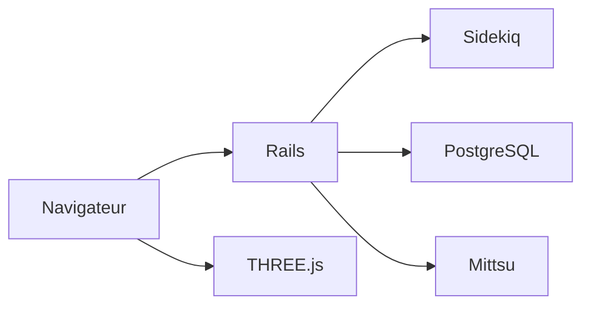

# manyfold3d/manyfold

> Self-hosted web application for managing a collection of 3D models, mainly for 3D printing.

## The problem
3D model files pile up with no catalog or preview.

## What it actually does
A Ruby on Rails application with a Sidekiq job runner; 3D rendering on the client with THREE.js, on the server with Mittsu; PostgreSQL in production, SQLite in development; ActivityPub for federation. Installation instructions are on manyfold.app; the README mostly describes development.

## How it is wired


## Trying it
```bash
bin/dev
bundle exec rake
docker build -f docker/default.dockerfile .
```

## Cost and gotchas
Free. For development: Ruby 3.4, Node 24, libarchive, imagemagick, assimp; ngrok expected by `bin/dev`. AGPL-3.0: obligations if exposed as a service.

## What it is not
Not 3D modeling or print slicing software: a catalog.

## Alternatives
No alternative named in the README.

## For you
Ignore: 3D file management, no value for data/AI/MLOps.
