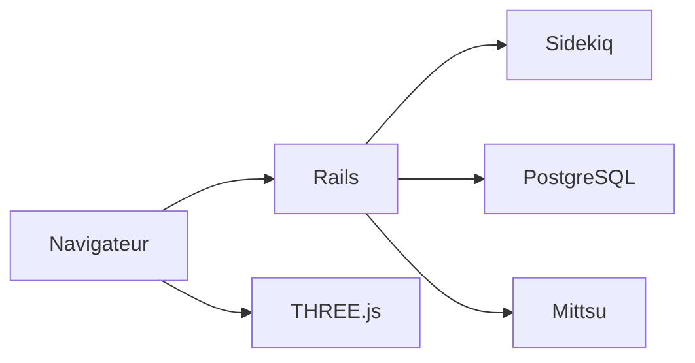

# manyfold3d/manyfold

> Application web auto-hébergée pour gérer une collection de modèles 3D, surtout pour l'impression 3D.

## Le problème
Les fichiers de modèles 3D s'accumulent sans catalogue ni aperçu.

## Ce que ça fait vraiment
Application Ruby on Rails avec un exécuteur de tâches Sidekiq ; rendu 3D côté client avec THREE.js, côté serveur avec Mittsu ; PostgreSQL en production, SQLite en développement ; ActivityPub pour la fédération. Les instructions d'installation sont sur manyfold.app ; le README décrit surtout le développement.

## Comment c'est branché


## Essayer
```bash
bin/dev
bundle exec rake
docker build -f docker/default.dockerfile .
```

## Coût et pièges
Gratuit. Pour développer : Ruby 3.4, Node 24, libarchive, imagemagick, assimp ; ngrok attendu par `bin/dev`. AGPL-3.0 : obligations en cas d'exposition en service.

## Ce que ce n'est pas
Pas un logiciel de modélisation ni de découpage pour impression : un catalogue.

## Alternatives
Aucune alternative nommée dans le README.

## Pour toi
À ignorer : gestion de fichiers 3D, aucune valeur pour data/IA/MLOps.

