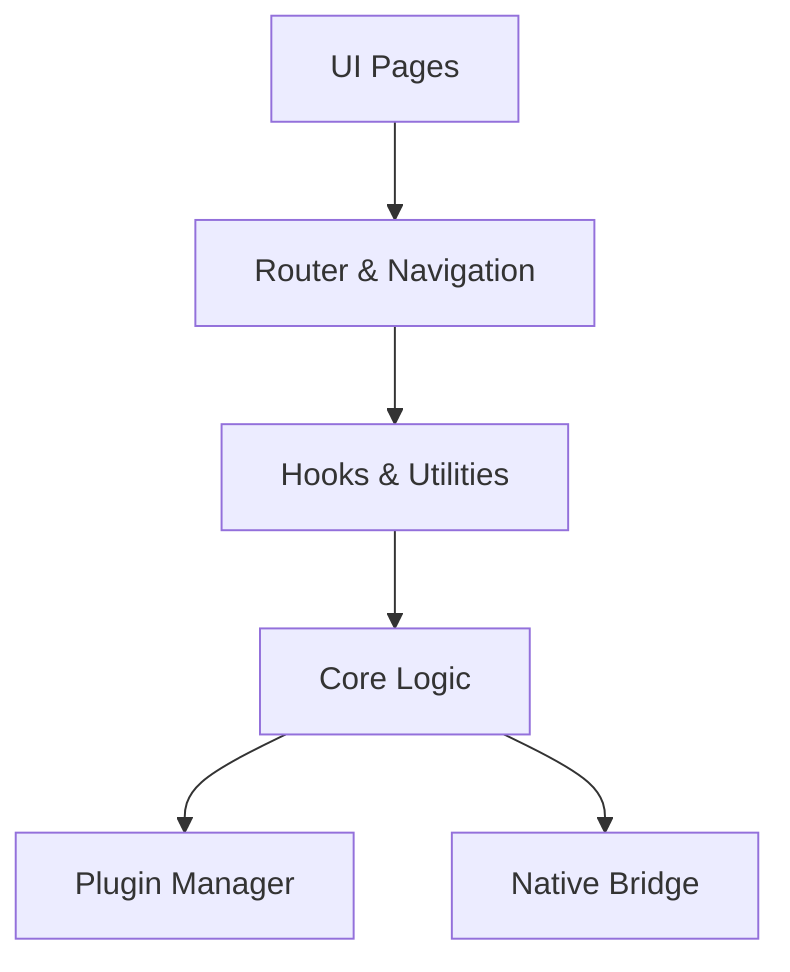

# maotoumao/MusicFree

> A free, ad-free, plugin-based music player for Android and HarmonyOS.

## The problem
Listen to music from several sources without an ad-laden app.

## What it actually does
The player integrates no source: search, playback, playlist import and lyrics all go through plugins (CommonJS modules). Data is stored locally. Light and dark themes, lyrics association between tracks. React Native with native Android and iOS modules.

## How it is wired

## Trying it
No command documented in the README (download from the releases page, plugins installed in the settings).

## Cost and gotchas
Free, but third-party plugins must be audited; their data and copyright are not the project's concern. The author warns of an irregular update pace and unstable versions.

## What it is not
It is not a music service: without a plugin, no source. Adds a non-commercial-use request on top of the AGPL.

## Alternatives
No alternative named in the README.

## For you
Ignore: outside your scope, unstable and dependent on third-party plugins with unclear rights.
