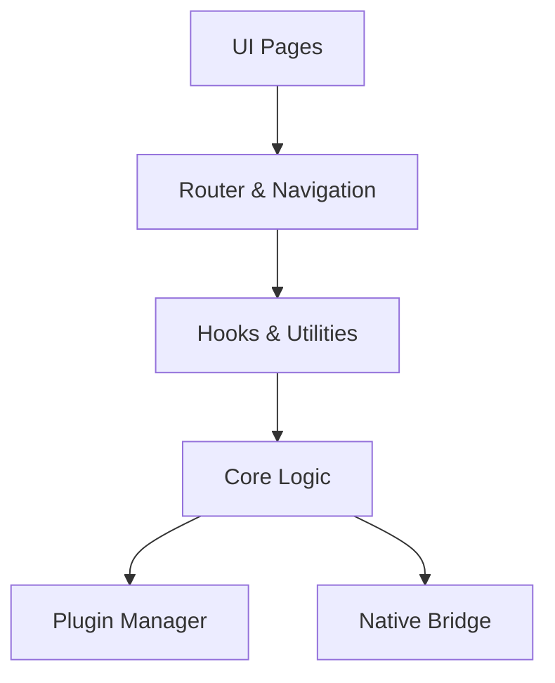

# maotoumao/MusicFree

> Lecteur de musique gratuit à plugins pour Android et HarmonyOS, sans publicité.

## Le problème
Écouter de la musique depuis plusieurs sources sans application chargée de publicité.

## Ce que ça fait vraiment
Le lecteur n'intègre aucune source : recherche, lecture, import de playlists et paroles passent par des plugins (modules CommonJS). Données stockées en local. Thèmes clair et sombre, association de paroles entre morceaux. React Native avec modules natifs Android et iOS.

## Comment c'est branché

## Essayer
Aucune commande documentée dans le README (téléchargement depuis la page des versions, plugins installés dans les réglages).

## Coût et pièges
Gratuit, mais les plugins tiers sont à auditer ; leurs données et droits d'auteur ne regardent pas le projet. L'auteur prévient d'un rythme de mise à jour irrégulier et de versions instables.

## Ce que ce n'est pas
Ce n'est pas un service de musique : sans plugin, aucune source. Ajoute à l'AGPL une demande d'usage non commercial.

## Alternatives
Aucune alternative nommée dans le README.

## Pour toi
À ignorer : hors de ton périmètre, instable et dépendant de plugins tiers aux droits flous.

