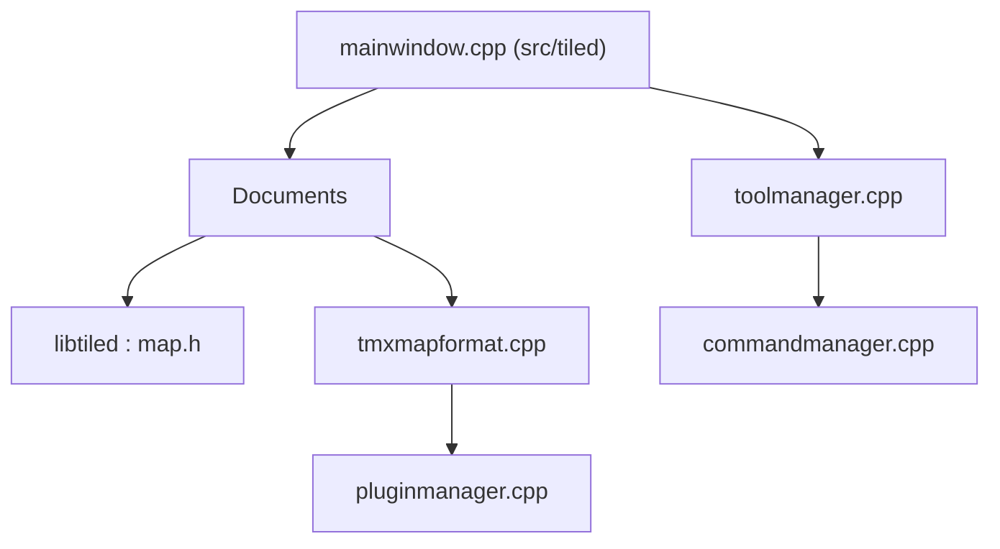

# mapeditor/tiled

> Tile map editor for 2D games, with the TMX format and scripting, for game developers.

## The problem
Drawing and organizing tile-based levels without a dedicated tool is slow and poorly portable between engines.

## What it actually does
Edits maps, layers, tilesets and objects, with arbitrary properties. Handles orthogonal, isometric and hexagonal maps. Imports and exports to several formats (JSON, Lua, GameMaker, Defold). Offers scripting, a Python plugin, undo/redo, as well as command-line tools (rasterizer, viewer).

## How it is wired


## Trying it
```bash
qbs setup-toolchains --detect
qbs
qbs run -p tiled
```
These commands build from source; the README also offers AppImage, Flatpak, snap and installers.

## Cost and gotchas
Free. Building requires Qt 6.2 or later and Qbs. License not identified by GitHub; to be checked. 851 open issues.

## What it is not
It is not a game engine: it produces maps that your engine has to load.

## Alternatives
No alternative named in the README.

## For you
Off-topic for data/AI/MLOps: ignore, unless you are prototyping a game or a 2D grid simulation environment.
