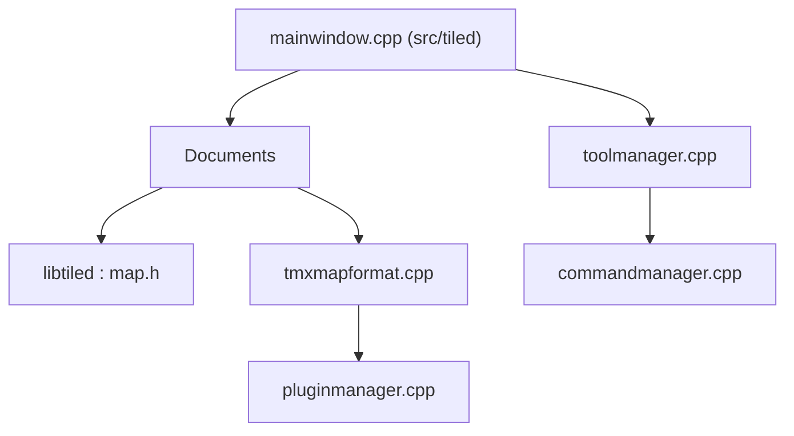

# mapeditor/tiled

> Éditeur de cartes en tuiles pour jeux 2D, avec format TMX et scripts, pour développeurs de jeux.

## Le problème
Dessiner et organiser des niveaux à base de tuiles sans outil dédié est long et peu portable entre moteurs.

## Ce que ça fait vraiment
Édite cartes, calques, tilesets et objets, avec propriétés arbitraires. Gère les cartes orthogonales, isométriques et hexagonales. Importe et exporte vers plusieurs formats (JSON, Lua, GameMaker, Defold). Offre scripts, plugin Python, annulation/rétablissement, ainsi que des outils en ligne de commande (rasterizer, viewer).

## Comment c'est branché


## Essayer
```bash
qbs setup-toolchains --detect
qbs
qbs run -p tiled
```
Ces commandes compilent depuis les sources ; le README propose aussi les versions AppImage, Flatpak, snap et les installeurs.

## Coût et pièges
Gratuit. Compilation : Qt 6.2 ou plus et Qbs. Licence non identifiée par GitHub ; à vérifier. 851 issues ouvertes.

## Ce que ce n'est pas
Ce n'est pas un moteur de jeu : il produit des cartes que ton moteur doit charger.

## Alternatives
Aucune alternative nommée dans le README.

## Pour toi
Hors sujet pour data/IA/MLOps : à ignorer, sauf si tu prototypes un jeu ou un environnement de simulation 2D en grille.

