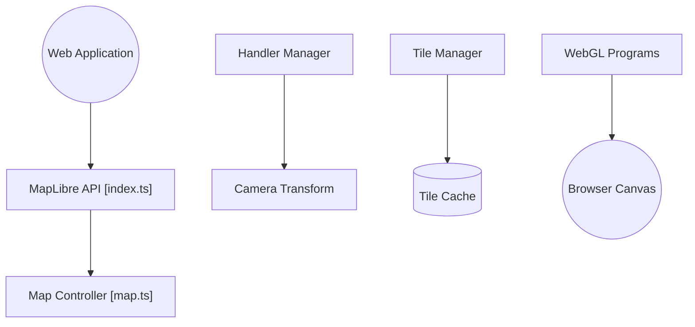

# maplibre/maplibre-gl-js

> JavaScript library for displaying vector maps in a browser via WebGL, forked from mapbox-gl-js.

## The problem
Publishing interactive maps on the web without depending on a library under a non-free license.

## What it actually does
You create a `Map` object that handles interaction and the camera, loads the sources and tiles described by a style, prepares symbols and draws the layers in WebGL. The code also handles terrain, glyphs, images and projections. Bindings exist for React and Angular.

## How it is wired


## Trying it
```bash
# README : inclure le CSS et le module depuis unpkg
# <link href='https://unpkg.com/maplibre-gl@latest/dist/maplibre-gl.css' rel='stylesheet' />
# import * as maplibregl from 'https://unpkg.com/maplibre-gl@latest/dist/maplibre-gl.mjs';
```

## Cost and gotchas
Free, but you must supply a style and a tile source; the demo uses `demotiles.maplibre.org`. The license is present but not identified by GitHub.

## What it is not
Not a map data provider: the library displays, the tiles come from elsewhere.

## Alternatives
- mapbox-gl-js: the project it was forked from, but moved to a non-free license in 2020.

## For you
Worth watching: useful for a geographic data dashboard, otherwise unrelated to your core work.
