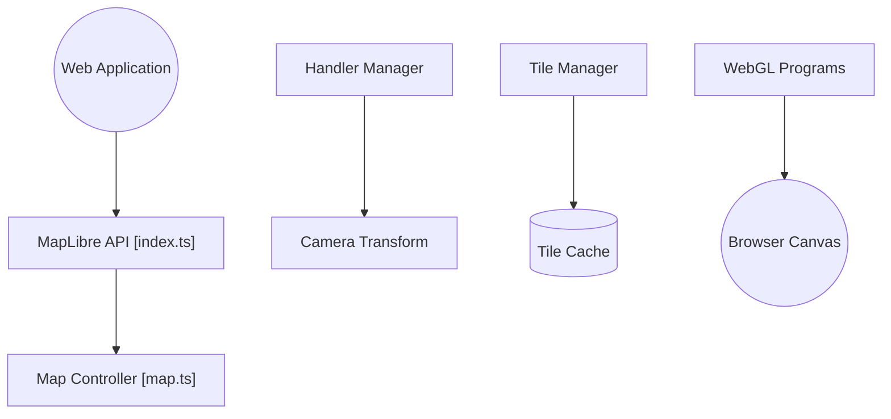

# maplibre/maplibre-gl-js

> Bibliothèque JavaScript pour afficher des cartes vectorielles dans un navigateur via WebGL, issue d'un fork de mapbox-gl-js.

## Le problème
Publier des cartes interactives sur le web sans dépendre d'une bibliothèque sous licence non libre.

## Ce que ça fait vraiment
On crée un objet `Map` qui gère l'interaction, la caméra, charge les sources et tuiles décrites par un style, prépare les symboles et dessine les couches en WebGL. Le code gère aussi le terrain, les glyphes, les images et les projections. Des liaisons existent pour React et Angular.

## Comment c'est branché


## Essayer
```bash
# README : inclure le CSS et le module depuis unpkg
# <link href='https://unpkg.com/maplibre-gl@latest/dist/maplibre-gl.css' rel='stylesheet' />
# import * as maplibregl from 'https://unpkg.com/maplibre-gl@latest/dist/maplibre-gl.mjs';
```

## Coût et pièges
Gratuit, mais il faut fournir un style et une source de tuiles ; la démo utilise `demotiles.maplibre.org`. La licence est présente mais non identifiée par GitHub.

## Ce que ce n'est pas
Pas un fournisseur de données cartographiques : la bibliothèque affiche, les tuiles viennent d'ailleurs.

## Alternatives
- mapbox-gl-js : dont il est issu, mais passé sous licence non libre en 2020.

## Pour toi
À surveiller : utile pour un tableau de bord de données géographiques, sinon sans lien avec ton cœur de métier.

