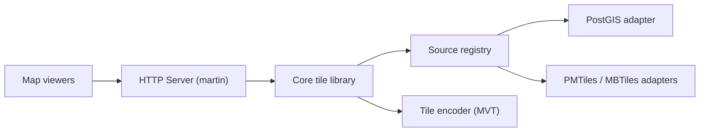

# maplibre/martin

> Vector tile server in Rust, fed by PostGIS, PMTiles, MBTiles or GeoJSON, for cartographers.

## The problem
Serving high-traffic vector maps from large geographic databases without pre-generating every tile.

## What it actually does
Generates tiles on the fly from PostgreSQL/PostGIS (tables and functions discovered automatically), GeoJSON, PMTiles and MBTiles; GeoParquet via DuckDB is unstable. Also serves styles, sprites and fonts, relays an upstream server and combines sources. `martin cp` produces tiles in bulk, the `mbtiles` tool manipulates the files.

## How it is wired

## Trying it
No command documented in the README provided: it points to the documentation (Quick Start, installation, CLI or configuration file).

## Cost and gotchas
Free. A PostGIS database is the central use case; otherwise PMTiles or MBTiles files are enough. The README details neither the installation nor the resources.

## What it is not
It is not a map client nor a geospatial analysis tool: it only serves tiles.

## Alternatives
No alternative named in the README.

## For you
Worth watching: useful if you publish geographic data or map results, outside the scope of a data / AI profile with no need for maps.
