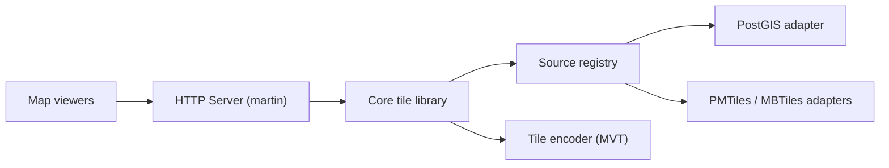

# maplibre/martin

> Serveur de tuiles vectorielles en Rust, alimenté par PostGIS, PMTiles, MBTiles ou GeoJSON, pour cartographes.

## Le problème
Servir des cartes vectorielles à fort trafic depuis de grosses bases géographiques sans pré-générer toutes les tuiles.

## Ce que ça fait vraiment
Génère à la volée des tuiles depuis PostgreSQL/PostGIS (tables et fonctions découvertes automatiquement), GeoJSON, PMTiles et MBTiles ; GeoParquet via DuckDB est instable. Sert aussi styles, sprites et polices, relaie un serveur amont et combine des sources. `martin cp` produit des tuiles en lot, l'outil `mbtiles` manipule les fichiers.

## Comment c'est branché

## Essayer
Aucune commande documentée dans le README fourni : il renvoie à la documentation (Quick Start, installation, CLI ou fichier de configuration).

## Coût et pièges
Gratuit. Une base PostGIS est le cas d'usage central ; sinon des fichiers PMTiles ou MBTiles suffisent. Le README ne détaille ni l'installation ni les ressources.

## Ce que ce n'est pas
Ce n'est pas un client cartographique ni un outil d'analyse géospatiale : il ne fait que servir des tuiles.

## Alternatives
Aucune alternative nommée dans le README.

## Pour toi
À surveiller : utile si tu publies des données géographiques ou des résultats cartographiques, hors périmètre d'un profil data / IA sans besoin de cartes.

