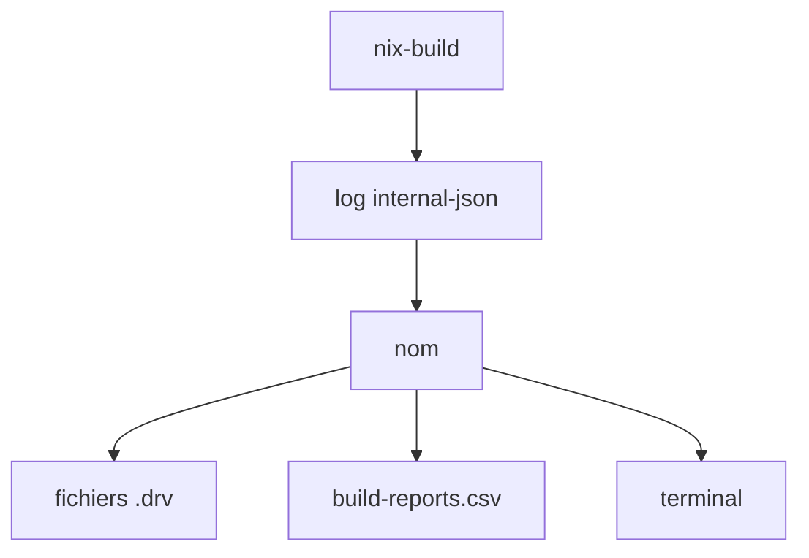

# maralorn/nix-output-monitor

> Haskell wrapper that displays the dependency tree, durations and downloads during Nix builds.

## The problem
The raw output of `nix build` is unreadable: you can't see what is running, what remains, or the failures.

## What it actually does
`nom` reads nix output (JSON or text) and draws at the bottom of the terminal the derivation tree with states, downloads and uploads. It compares against the median of the last 10 builds, stored in a local CSV. `nom build`, `shell` and `develop` replace the nix commands.

## How it is wired


## Trying it
```bash
nom build
nix-build --log-format internal-json -v |& nom --json
nix-build |& nom
```

## Cost and gotchas
Free. `nom shell` and `nom develop` call nix twice: doubled evaluation. Icon fonts recommended.

## What it is not
Not a build tool or a cache. It can be wrong in text mode, and assumes a store in `/nix/store`. No license declared in the catalog.

## Alternatives
No alternative named in the README.

## For you
Watch: valuable if you use Nix for reproducible environments; otherwise irrelevant, and the missing license prevents any safe reuse.
