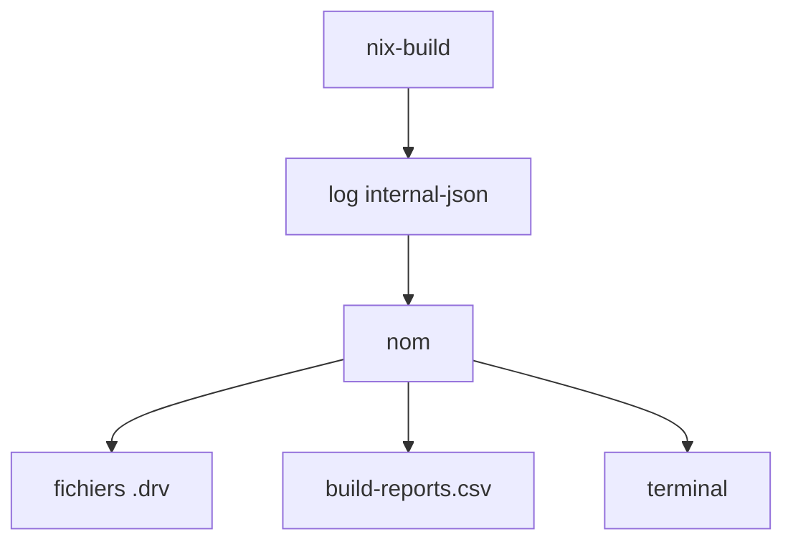

# maralorn/nix-output-monitor

> Surcouche en Haskell qui affiche arbre de dépendances, durées et téléchargements pendant les builds Nix.

## Le problème
La sortie brute de `nix build` est illisible : on ne voit ni ce qui tourne, ni ce qui reste, ni les échecs.

## Ce que ça fait vraiment
`nom` lit la sortie de nix (JSON ou texte) et dessine en bas du terminal l'arbre des dérivations avec états, téléchargements et uploads. Il compare à la médiane des 10 derniers builds, stockée dans un CSV local. `nom build`, `shell` et `develop` remplacent les commandes nix.

## Comment c'est branché


## Essayer
```bash
nom build
nix-build --log-format internal-json -v |& nom --json
nix-build |& nom
```

## Coût et pièges
Gratuit. `nom shell` et `nom develop` appellent nix deux fois : évaluation doublée. Polices à icônes recommandées.

## Ce que ce n'est pas
Pas un outil de build ni de cache. Il peut se tromper en mode texte, et suppose un store en `/nix/store`. Aucune licence déclarée dans le catalogue.

## Alternatives
Aucune alternative nommée dans le README.

## Pour toi
À surveiller : précieux si tu utilises Nix pour des environnements reproductibles ; sinon sans objet, et la licence absente empêche toute réutilisation sûre.

