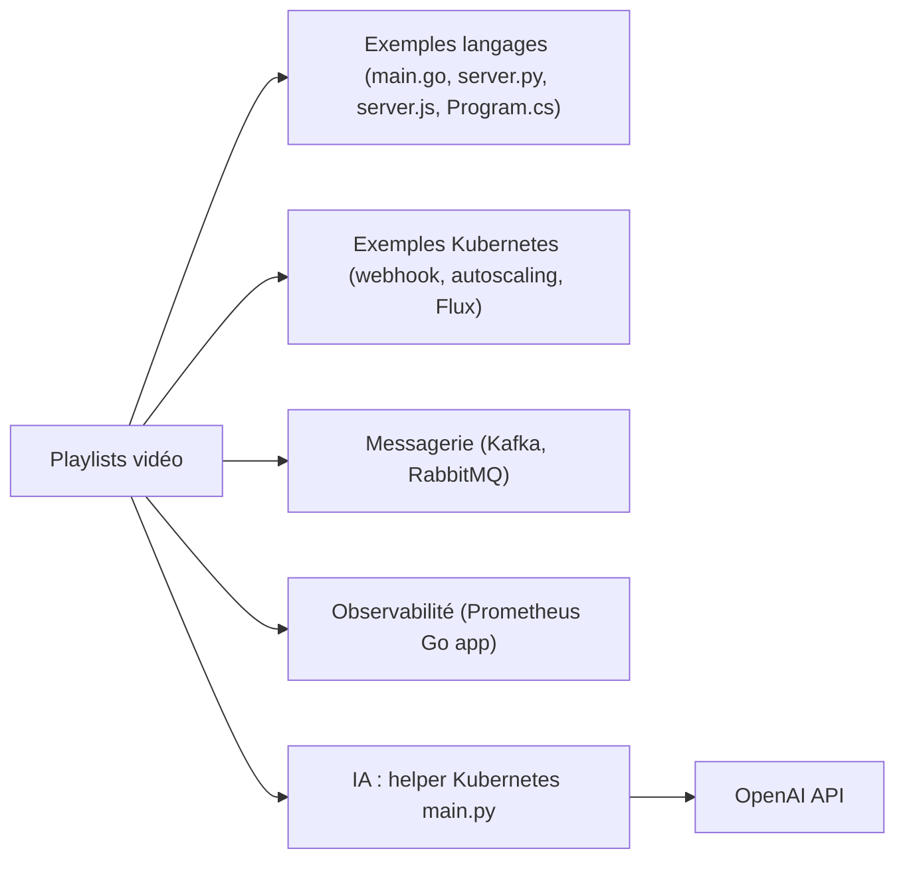

# marcel-dempers/docker-development-youtube-series

> A collection of source code accompanying DevOps videos (Docker, Kubernetes, Kafka, observability), aimed at learners.

## The problem
Video tutorials without accompanying code force you to retype everything. Here, each series has its own folder of runnable source.

## What it actually does
It is not an application but a box of independent examples: small HTTP servers in Go, Python, Node and .NET, a Kubernetes admission webhook, autoscaling, Flux, Kafka and RabbitMQ producers/consumers, a Go app instrumented for Prometheus, log parsers, a video API example, and a Kubernetes cheat sheet in Python that calls the OpenAI API. The README is a table of playlists pointing to the code. Most of the examples have no link with each other.

## How it is wired


## Trying it
```bash
# Aucune commande unique dans le README : chaque sujet a son dossier source,
# référencé depuis les descriptions des vidéos.
```

## Cost and gotchas
Free; Docker for most of the examples, an OpenAI key for the AI example. The code is tied to the videos: without them the context is missing, and some series are old (the repository was created in 2019).

## What it is not
Not an integrated toolbox despite the title "Ultimate Engineer Toolbox": these are isolated demonstrations. No license is declared, so reusing the code is legally uncertain.

## Alternatives
Not documented in the README: no alternative is named.

## For you
Keep in reserve as Docker/Kubernetes teaching material if you build up MLOps skills; nothing to adopt for a data or AI pipeline, and the lack of a license limits reuse.
