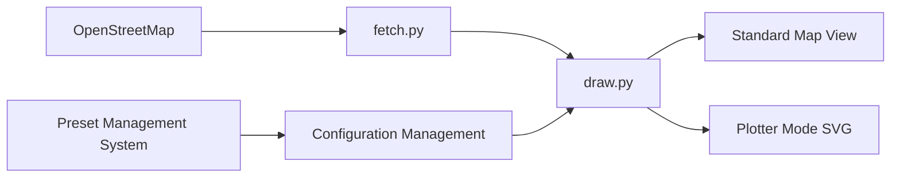

# marceloprates/prettymaps

> Python library for drawing stylized maps from OpenStreetMap.

## The problem
Producing a nice map of a neighborhood requires fetching the OSM layers and styling everything by hand.

## What it actually does
`prettymaps.plot('address')` fetches the OSM layers via osmnx and draws with matplotlib/shapely.
`layers`, `style` parameters, JSON presets, clipping shape (`circle`, `radius`).
Returns the GeoDataFrames per layer; plotter mode via vsketch.
Streamlit front end and marimo tutorial.

## How it is wired


## Trying it
```bash
pip install prettymaps
streamlit run app.py
marimo edit notebooks/tutorial.py
```

## Cost and gotchas
Free; depends on OSM requests. Credit to OpenStreetMap is mandatory on figures.

## What it is not
Not a geospatial analysis tool; the author refuses any NFT use (without being able to enforce it legally).

## Alternatives
No alternative named in the README.

## For you
Ignore for ML work; possibly nice for a geo illustration, with no analytical value.
