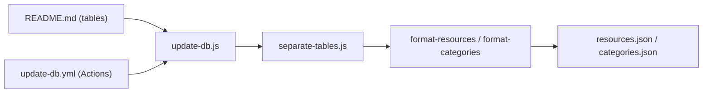

# marcelscruz/public-apis

> A list of free public APIs sorted by category, with authentication and CORS details, for developers looking for a data source.

## The problem
Finding a reliable public API for a prototype or a dataset means digging through the web.

## What it actually does
A README made of tables (name, description, authentication type, CORS) spread over more than 50 categories: AI, finance, weather, geocoding, open data, science, health, etc. A derived JSON base (`db/resources.json`, `db/categories.json`) is regenerated by a Node script (`scripts/db/update-db.js`) and a GitHub Actions workflow. No server.

## How it is wired

## Trying it
The README is a catalogue: it contains no installation command.

## Cost and gotchas
The list is free, but many of the listed APIs require a key (`apiKey`) or OAuth, and some are paid or rate-limited. Entries are declared by contributors: their availability is not guaranteed.

## What it is not
It is neither a service nor a client: this repository calls no API.

## Alternatives
No alternative named in the README.

## For you
Keep an eye on it: handy as a directory of sources (open data, finance, weather, AI) to feed a data project, but to be cross-checked each time.
