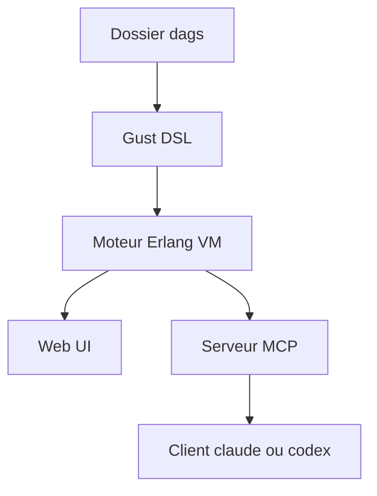

# marciok/gust

> Lightweight task orchestrator in Elixir, an Airflow alternative, with a web interface and an MCP server.

## The problem
Airflow requires several databases, services and containers before a first DAG runs.

## What it actually does
You write DAGs in Elixir, YAML, shell or Python in the `dags/` folder; Gust loads them, schedules them (cron) and displays them in a web interface. It handles retries with backoff, parallel mapping, conditional tasks and manual stopping. An MCP server lets an LLM list and launch DAGs. The README claims up to 4.4 times less memory than Airflow at idle (separate benchmark).

## How it is wired
Simplified diagram based on the fiche, no diagram provided.



## Trying it
```bash
claude mcp add --transport http gust-mcp http://localhost:4000/gust/mcp/server
gh skill install marciok/gust elixir-dag-creator
```

## Cost and gotchas
Free (MIT). The README points to a Docker quickstart without a command. DAGs are coded in Elixir (or YAML, shell, Python), so an uncommon stack in data. A single maintainer and a project less than a year old.

## What it is not
Not a proven replacement for Airflow: the figure comes from the author's benchmark. No connector ecosystem.

## Alternatives
- Apache Airflow: cited as the comparison reference, a much larger ecosystem.

## For you
Keep an eye on it: the idea is appealing if Airflow weighs on you, but it is young, has a single maintainer, and Elixir hinders adoption by a data team.
