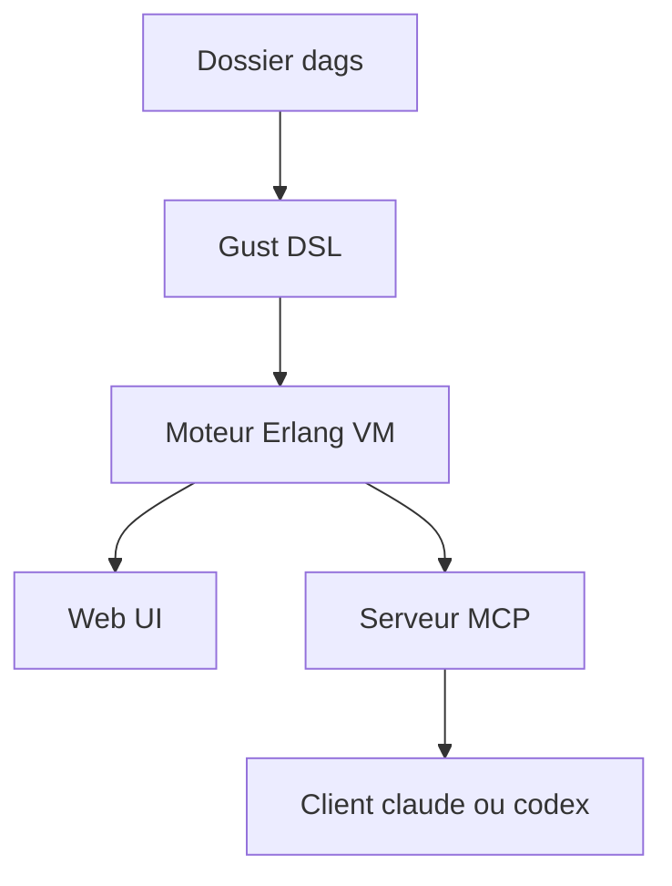

# marciok/gust

> Orchestrateur de tâches léger en Elixir, alternative à Airflow, avec interface web et serveur MCP.

## Le problème
Airflow demande plusieurs bases, services et conteneurs avant qu'un premier DAG ne tourne.

## Ce que ça fait vraiment
Tu écris des DAG en Elixir, YAML, shell ou Python dans le dossier `dags/` ; Gust les charge, les planifie (cron) et les affiche dans une interface web. Il gère les reprises avec attente progressive, le mapping parallèle, les tâches conditionnelles et l'arrêt manuel. Un serveur MCP permet à un LLM de lister et lancer les DAG. Le README annonce jusqu'à 4,4 fois moins de mémoire qu'Airflow au repos (benchmark à part).

## Comment c'est branché
Schéma simplifié d'après la fiche, sans diagramme fourni.



## Essayer
```bash
claude mcp add --transport http gust-mcp http://localhost:4000/gust/mcp/server
gh skill install marciok/gust elixir-dag-creator
```

## Coût et pièges
Gratuit (MIT). Le README renvoie vers un quickstart Docker sans commande. Les DAG se codent en Elixir (ou YAML, shell, Python), donc pile peu courante en data. Un seul mainteneur et projet de moins d'un an.

## Ce que ce n'est pas
Pas un remplaçant prouvé d'Airflow : le chiffre vient d'un benchmark de l'auteur. Pas d'écosystème de connecteurs.

## Alternatives
- Apache Airflow : cité comme référence de comparaison, écosystème bien plus large.

## Pour toi
À surveiller : l'idée est séduisante si Airflow te pèse, mais jeune, à mainteneur unique, et Elixir freine la reprise par une équipe data.

