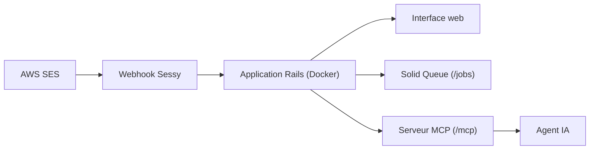

# marckohlbrugge/sessy

> Open source dashboard to track deliveries, bounces and clicks of emails sent through AWS SES.

## The problem
Amazon SES sends well but shows poorly what happens after sending. The services that fill this gap are often paid layers on top.

## What it actually does
Sessy displays deliveries, bounces, complaints, opens and clicks for an SES account. It embeds an MCP server at `/mcp`: an agent can search events, read a message's timeline and get statistics, read-only for email data. Background jobs run through Solid Queue, with a dashboard at `/jobs`.

## How it is wired
Simplified diagram based on the fiche, no diagram provided.


## Trying it
```bash
docker run -p 80:80 \
  -e SECRET_KEY_BASE=$(openssl rand -hex 64) \
  -e DISABLE_SSL=true \
  -v sessy:/rails/storage \
  ghcr.io/marckohlbrugge/sessy:main
claude mcp add --transport http sessy https://your-sessy-host/mcp \
  --header "Authorization: Bearer YOUR_API_KEY"
```

## Cost and gotchas
Free, but you need an already configured AWS SES account and a Docker host. Behind Cloudflare, the anti-bot protection blocks MCP clients: exempt `/mcp`. Enabling HTTP Basic authentication later does not revoke existing API keys.

## What it is not
It is not an email sending service: it observes SES, it does not replace it. A hosted version is in preparation and its code (`saas/`) lives in the repository, with no effect on self-hosting.

## Alternatives
No alternative named in the README.

## For you
Worth watching: no direct link to your data/AI work, but the example of an MCP plugged into observability data is instructive; license to be checked.
