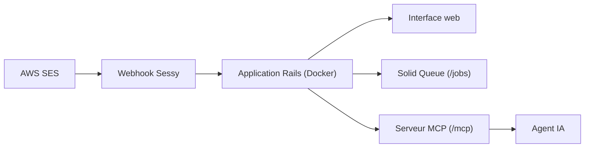

# marckohlbrugge/sessy

> Tableau de bord open source pour suivre livraisons, rebonds et clics des emails envoyés via AWS SES.

## Le problème
Amazon SES envoie bien mais montre mal ce qui arrive après l'envoi. Les services qui comblent ce manque sont souvent des surcouches payantes.

## Ce que ça fait vraiment
Sessy affiche livraisons, rebonds, plaintes, ouvertures et clics d'un compte SES. Il embarque un serveur MCP sur `/mcp` : un agent peut chercher des événements, lire la chronologie d'un message et obtenir des statistiques, en lecture seule pour les données d'email. Les tâches de fond passent par Solid Queue, avec un tableau de bord sur `/jobs`.

## Comment c'est branché
Schéma simplifié d'après la fiche, sans diagramme fourni.


## Essayer
```bash
docker run -p 80:80 \
  -e SECRET_KEY_BASE=$(openssl rand -hex 64) \
  -e DISABLE_SSL=true \
  -v sessy:/rails/storage \
  ghcr.io/marckohlbrugge/sessy:main
claude mcp add --transport http sessy https://your-sessy-host/mcp \
  --header "Authorization: Bearer YOUR_API_KEY"
```

## Coût et pièges
Gratuit, mais il faut un compte AWS SES déjà configuré et un hôte Docker. Derrière Cloudflare, la protection anti-bots bloque les clients MCP : exempte `/mcp`. Activer l'authentification HTTP Basic plus tard ne révoque pas les clés d'API existantes.

## Ce que ce n'est pas
Ce n'est pas un service d'envoi d'emails : il observe SES, il ne le remplace pas. Une version hébergée est en préparation et son code (`saas/`) cohabite dans le dépôt, sans effet sur l'auto-hébergement.

## Alternatives
Aucune alternative nommée dans le README.

## Pour toi
À surveiller : sans lien direct avec ton métier data/IA, mais l'exemple d'un MCP branché sur des données d'observabilité est instructif ; licence à vérifier.

