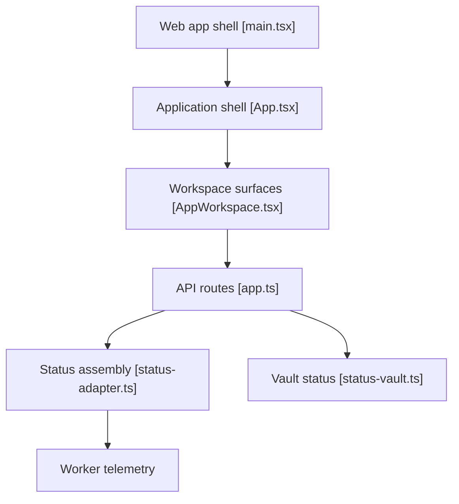

# marcusquinn/aidevops

> AI agent framework for OpenCode that carries work from intent to verified result, for developers and teams.

## The problem
Every task handed to an agent starts over from an isolated chat: lost context, non-isolated work, uncontrolled risky actions.

## What it actually does
Installs agents and commands in `~/.aidevops/agents/`, with isolated Git worktrees, tiered model routing (simple, standard, thinking) and a "Pulse" supervisor that launches workers. The part described by the code is a web interface (`gui-web`) with a local API (`gui-api`): Pulse status, vault, repositories. The rest of the agent engine is not in the analyzed tree.

## How it is wired


## Trying it
```bash
npm install -g aidevops && aidevops update
aidevops status
aidevops init
aidevops security
```

## Cost and gotchas
Requires model providers: API key or subscription accounts (Claude, ChatGPT, OpenCode Go). Pulse runs every 2 minutes and launches workers unattended: enable it only where authorized. The scope is huge (more than 2,000 sub-agents advertised).

## What it is not
Not a simple library: it is an entire environment with its own conventions. The "100x more capable" goal is, according to the README, an unmeasured ambition.

## Alternatives
No alternative named in the README (Claude Code and Codex CLI are cited there as supported runtimes).

## For you
Worth watching: ambitious and very active, but heavy and carried by a single person; test on a throwaway repository before plugging autonomy into it.
