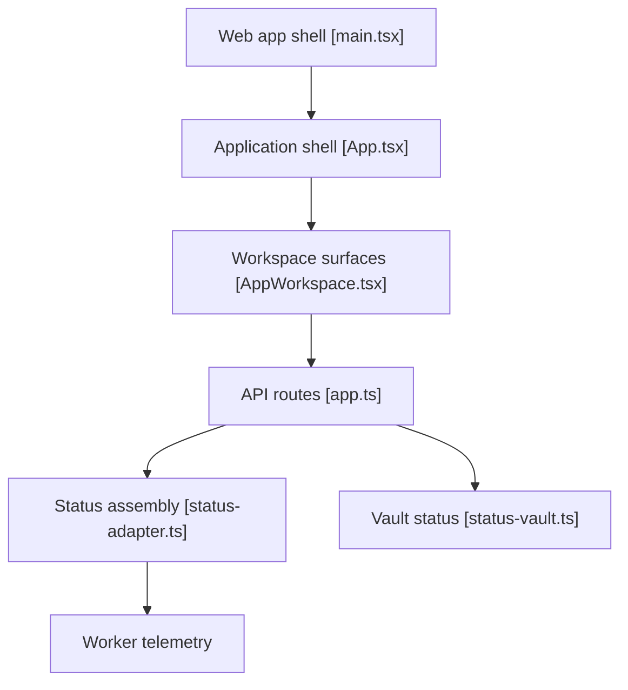

# marcusquinn/aidevops

> Cadre d'agents IA pour OpenCode qui mène un travail de l'intention au résultat vérifié, pour développeurs et équipes.

## Le problème
Chaque tâche confiée à un agent repart d'un chat isolé : contexte perdu, travail non isolé, actions risquées non contrôlées.

## Ce que ça fait vraiment
Installe des agents et des commandes dans `~/.aidevops/agents/`, avec des worktrees Git isolés, un routage de modèles par niveaux (simple, standard, thinking) et un superviseur « Pulse » qui lance des workers. La partie décrite par le code est une interface web (`gui-web`) avec une API locale (`gui-api`) : état de Pulse, coffre, dépôts. Le reste du moteur d'agents n'est pas dans l'arbre analysé.

## Comment c'est branché


## Essayer
```bash
npm install -g aidevops && aidevops update
aidevops status
aidevops init
aidevops security
```

## Coût et pièges
Demande des fournisseurs de modèles : clé d'API ou comptes d'abonnement (Claude, ChatGPT, OpenCode Go). Pulse tourne toutes les 2 minutes et lance des workers sans surveillance : à n'activer que là où c'est autorisé. Le périmètre est énorme (plus de 2 000 sous-agents annoncés).

## Ce que ce n'est pas
Pas une simple bibliothèque : c'est un environnement entier avec ses conventions. L'objectif « 100x plus capable » est, selon le README, une ambition non mesurée.

## Alternatives
Aucune alternative nommée dans le README (Claude Code et Codex CLI y sont cités comme runtimes pris en charge).

## Pour toi
Surveiller : ambitieux et très actif, mais lourd et porté par une seule personne ; à tester sur un dépôt jetable avant d'y brancher de l'autonomie.

