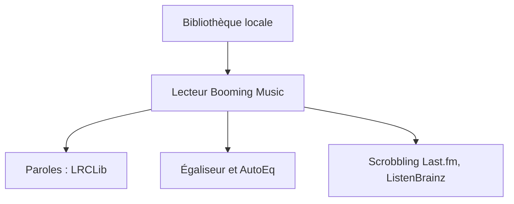

# mardous/BoomingMusic

> Android music player with a Material You design, synced lyrics and an equalizer.

## The problem
Local Android players rarely offer word-by-word lyrics, a fine equalizer and scrobbling in the same app.

## What it actually does
Android player derived from Retro Music Player: downloaded and synced lyrics (TTML or LRC, translations), 15-band equalizer with AutoEq profiles, gapless playback, ReplayGain, tag editor, Last.fm and ListenBrainz scrobbling, Android Auto, widgets, sleep timer.

## How it is wired
Simplified diagram based on the sheet, no diagram provided.



## Trying it
```bash
# Aucune commande documentée : le README ne décrit pas l'installation.
```

## Cost and gotchas
Free. The README does not say where to download the app. GPL-3.0 license (copyleft); 120 open issues.

## What it is not
Not a streaming service: it plays local files. No iOS or desktop version mentioned.

## Alternatives
- Retro Music Player: the base the project derives from.
- Gramophone: cited in the acknowledgments.

## For you
Ignore: Android music player unrelated to data / AI / MLOps work.
