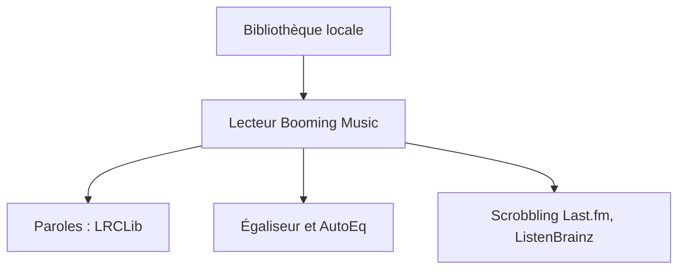

# mardous/BoomingMusic

> Lecteur de musique Android au design Material You, avec paroles synchronisées et égaliseur.

## Le problème
Les lecteurs locaux Android offrent rarement paroles mot à mot, égaliseur fin et scrobbling dans la même application.

## Ce que ça fait vraiment
Lecteur Android issu de Retro Music Player : paroles téléchargées et synchronisées (TTML ou LRC, traductions), égaliseur 15 bandes avec profils AutoEq, lecture sans silence, ReplayGain, éditeur de tags, scrobbling Last.fm et ListenBrainz, Android Auto, widgets, minuteur de sommeil.

## Comment c'est branché
Schéma simplifié d'après la fiche, sans diagramme fourni.



## Essayer
```bash
# Aucune commande documentée : le README ne décrit pas l'installation.
```

## Coût et pièges
Gratuit. Le README ne dit pas où télécharger l'application. Licence GPL-3.0 (copyleft) ; 120 issues ouvertes.

## Ce que ce n'est pas
Pas un service de streaming : il joue des fichiers locaux. Aucune version iOS ou desktop mentionnée.

## Alternatives
- Retro Music Player : la base dont le projet est issu.
- Gramophone : cité dans les remerciements.

## Pour toi
Ignorer : lecteur de musique Android sans rapport avec un travail data / IA / MLOps.

