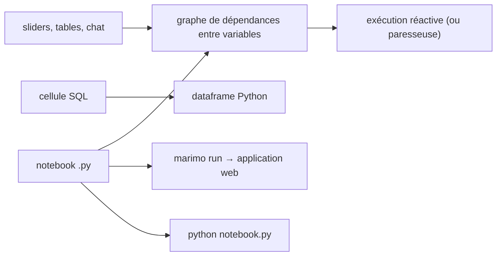

# marimo-team/marimo

> Reactive Python notebook stored as `.py`, runnable as a script and deployable as an application.

## The problem
A Jupyter notebook lies: the execution order is not the page order, deleted variables
survive in memory, and the versioned JSON produces unreadable diffs.

## What it actually does
Cells are linked by their variable references, not by their position: running a
cell reruns the dependent ones or marks them stale, and deleting a cell erases its
variables from memory. The file is pure Python, so `python mon_notebook.py` works,
and `marimo run` serves it as a web application with the code hidden. Built-in SQL cells rendering a
dataframe, UI elements bound without callbacks, built-in package management with a venv sandbox,
WASM export, `pytest` on notebooks, conversion from `.ipynb`.

## How it is wired


## Trying it
```bash
pip install marimo
marimo tutorial intro
marimo edit
marimo run your_notebook.py
marimo convert your_notebook.ipynb > your_notebook.py
```

## Cost and gotchas
Free. The gotcha is the reactivity itself: on an expensive notebook, a change can
rerun the whole chain — the README then recommends configuring the runtime in lazy mode,
which marks cells as stale instead of running them. `pip install "marimo[recommended]"`
is required for SQL cells and AI completion.

## What it is not
Not a Jupyter-compatible tool: it is a different execution model, with documented one-way
conversion. Not an enterprise dashboard, even though `marimo run` comes close. molab is a
separate cloud service, compared by the README to Google Colab.

## Alternatives
- Jupyter / jupytext / papermill / streamlit / ipywidgets: what the README claims to replace.
- Pluto.jl, ObservableHQ, IPyflow: the cited sources of inspiration.

## For you
The credible Jupyter replacement for your versioned analyses — it is the most directly useful repository of the batch.
