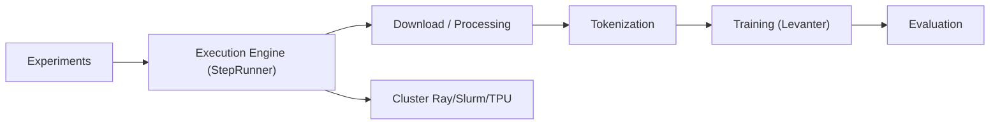

# marin-community/marin

> Research program and open platform for training foundation models, with the whole process documented.

## The problem
LLM training recipes (data, mixture, scaling) remain opaque and hard to reproduce.

## What it actually does
Experiments defined as dependent steps executed in topological order, like a Makefile: download, transformation, tokenization, training (Levanter), evaluation, export. Checkpoints and data from the "Delphi" suite published; Flask/React data browser; execution on Ray, Slurm or TPU.

## How it is wired


## Trying it
```bash
# Extrait : le README fournit un script Python (TinyStories) lancé par
# StepRunner().run([lower(nano_tinystories_model)]) ;
# commandes d'installation dans la documentation liée.
```

## Cost and gotchas
Compute (GPU/TPU) dominates the bill; tracking with Weights & Biases and Hugging Face. More than 600 open issues.

## What it is not
Not a lightweight tool: a large-scale research framework, oriented toward foundation models rather than one-off fine-tuning.

## Alternatives
- No alternative cited in the README.

## For you
Keep an eye on it: very instructive about the reproducibility of LLM training; impractical without access to substantial compute.
