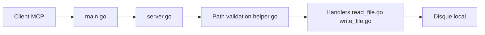

# mark3labs/mcp-filesystem-server

> Go MCP server giving an AI client controlled access to the local file system.

## The problem
An AI assistant can neither read nor modify your files without a secure bridge that limits where it can go.

## What it actually does
Exposes through MCP tools for reading, writing, copying, moving, deleting, modifying (text or regex), listing, tree, search by name or content, and metadata. Every path is validated against allowed directories, with symbolic link resolution. Also usable as a Go library.

## How it is wired


## Trying it
```bash
go install github.com/mark3labs/mcp-filesystem-server@latest
mcp-filesystem-server /path/to/allowed/directory
docker run -i --rm ghcr.io/mark3labs/mcp-filesystem-server:latest /path/to/allowed/directory
```

## Cost and gotchas
Free. Write and delete tools are exposed: only declare safe folders; with Docker, mount a volume so that changes persist.

## What it is not
Not a full sandbox: protection relies on path validation. Last push late 2025, 27 open issues.

## Alternatives
No alternative cited in the README.

## For you
Worth watching: a simple, clean MCP building block to give files to an agent, to be restricted to a dedicated working folder.
