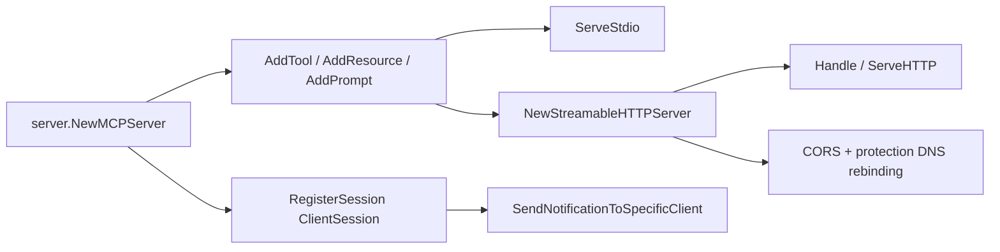

# mark3labs/mcp-go

> Go SDK for writing Model Context Protocol servers exposing tools, resources and prompts.

## The problem
Implementing MCP by hand in Go forces you to handle JSON-RPC, sessions, transports and spec versions before writing the first tool.

## What it actually does
`server.NewMCPServer` plus `AddTool`, `AddResource`, `AddResourceTemplate`, `AddPrompt` cover most of the spec.
Implements MCP 2025-11-25, backward compatible with 2025-06-18, 2025-03-26 and 2024-11-05.
Task-augmented tools (`AddTaskTool`) for long-running work: the server returns an ID, the client polls `tasks/result`.
Transports stdio, SSE and streamable-HTTP; `StreamableHTTPServer` is an `http.Handler`, with a `Handle` entry point for fasthttp or fiber.

## How it is wired


## Trying it
```bash
go get github.com/mark3labs/mcp-go
```

## Cost and gotchas
Free, nothing to install besides Go. The README warns that the project is under active development, like the spec: advanced features are incomplete. Without `WithMaxConcurrentTasks`, the number of concurrent tasks is not bounded.

## What it is not
Not an exhaustive implementation of the spec: the README writes "Complete*" with the asterisk on "aims". Not an MCP client. DNS rebinding protection applies to loopback connections: behind a local reverse proxy you must rewrite the `Host` or disable it explicitly.

## Alternatives
No competing SDK named in the README.

## For you
The obvious choice if you expose an internal tool over MCP from Go; look at task tools for long jobs.
