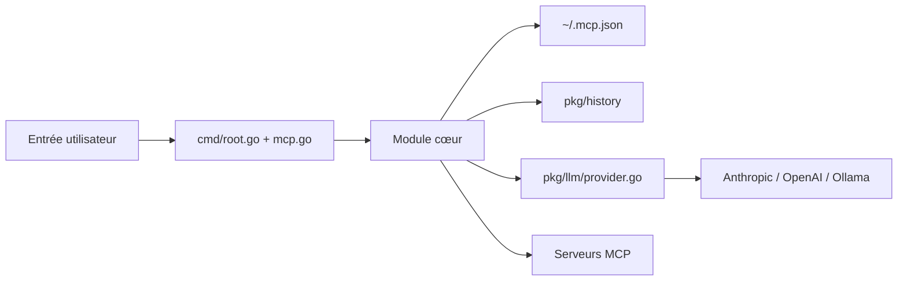

# mark3labs/mcphost

> Command-line interface that connects LLMs to MCP servers; abandoned in favor of Kit.

## The problem
A language model alone cannot call external tools; you need a host that manages MCP connections and history.

## What it actually does
Go program that runs interactive conversations or non-interactive mode (`-p`), with Claude, OpenAI, Gemini, Ollama or an OpenAI-compatible endpoint. It drives several MCP servers (local, remote, built-in fs/bash/todo/http), filters tools per server, and offers YAML scripts, before/after-tool hooks and a Go SDK. The README announces the end of development and points to Kit.

## How it is wired


## Trying it
```bash
go install github.com/mark3labs/mcphost@latest
mcphost
mcphost -p "What is 2+2?" --quiet
mcphost -m ollama/qwen2.5:3b
```

## Cost and gotchas
API key of the chosen provider at your expense, or local Ollama. Hooks run arbitrary commands; `--tls-skip-verify` disables TLS verification.

## What it is not
No longer maintained: archived repository, no fixes. The README is partly truncated (badly closed code blocks).

## Alternatives
Kit, the successor named at the top of the README.

## For you
Ignore: archived, and its successor Kit is the logical entry point for a CLI MCP host.
