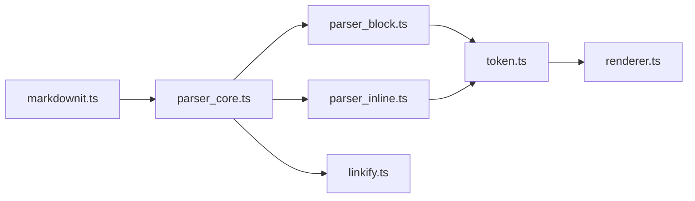

# markdown-it/markdown-it

> Extensible JavaScript Markdown parser, CommonMark-compliant, for tool or site developers.

## The problem
Converting Markdown to HTML in a reliable, safe and customizable way (added or replaced syntaxes).

## What it actually does
A `MarkdownIt` instance takes a text, chains core rules, then block and inline parsing, produces a token stream, which the renderer turns into HTML. Follows CommonMark with extensions (URL autolinking, typography), replaceable rules, "safe by default". Community plugins exist on npm.

## How it is wired


## Trying it
```bash
npm install markdown-it
```
```js
import MarkdownIt from 'markdown-it'
const md = new MarkdownIt()
const result = md.render('# markdown-it rulezz!')
```

## Cost and gotchas
Free. A README note flags a migration required to move to v15.

## What it is not
Not an editor nor a template engine: it only converts Markdown to HTML.

## Alternatives
No alternative named in the README.

## For you
A good choice if you generate reports or a chat/RAG interface in JS that displays Markdown; in Python, out of scope.
