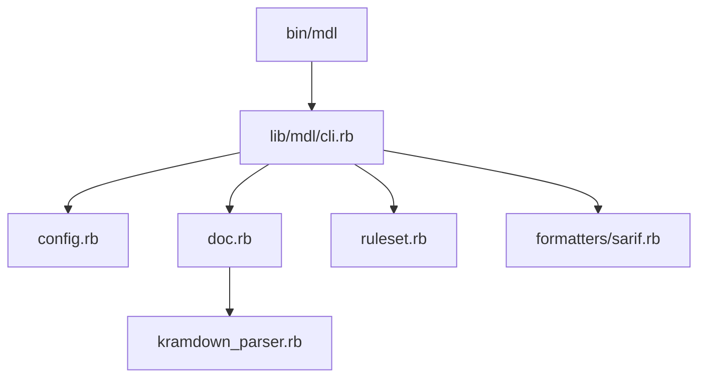

# markdownlint/markdownlint

> Ruby linter (mdl) that checks the style of Markdown files, for teams that write documentation.

## The problem
Markdown docs drift in style (line length, lists, headings) and manual review cannot keep up.

## What it actually does
The mdl command reads files, a folder or standard input, applies rules (MD013, MD029...) and prints the line number and the violated rule. Styles are configured per file, you can write your own rules, and the output can be switched to SARIF.

## How it is wired


## Trying it
```bash
gem install mdl
mdl README.md
mdl docs/
```

## Cost and gotchas
Requires Ruby and RubyGems, no Python or Node. The default rules reflect the author's tastes: plan for a style file.

## What it is not
Not an automatic fixer: it reports, it does not rewrite. It is not the Node.js version of the same name.

## Alternatives
- markdownlint (Node.js): same idea, JS ecosystem.
- markdownlint-cli and markdownlint-cli2: CLIs of the Node version.

## For you
Watch: only if you have a docs CI and Ruby does not bother you; otherwise prefer the Node variant.
