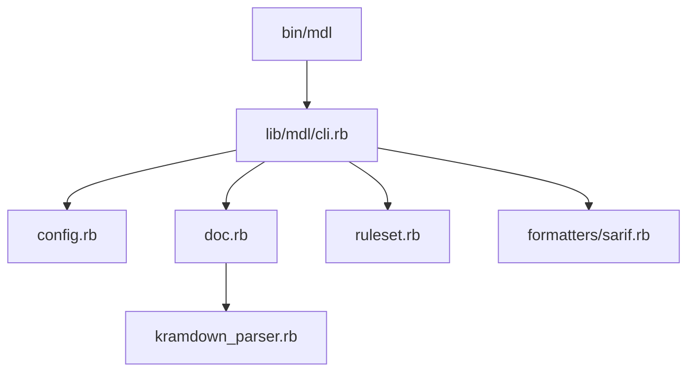

# markdownlint/markdownlint

> Linter Ruby (mdl) qui vérifie le style des fichiers Markdown, pour équipes qui documentent.

## Le problème
Les docs Markdown dérivent en style (longueur de lignes, listes, titres) et la relecture manuelle ne suit pas.

## Ce que ça fait vraiment
La commande mdl lit des fichiers, un dossier ou l'entrée standard, applique des règles (MD013, MD029...) et affiche numéro de ligne et règle violée. Les styles se configurent par fichier, on peut écrire ses propres règles, et la sortie peut passer en SARIF.

## Comment c'est branché


## Essayer
```bash
gem install mdl
mdl README.md
mdl docs/
```

## Coût et pièges
Demande Ruby et RubyGems, pas de Python ni Node. Les règles par défaut reflètent les goûts de l'auteur : prévoir un fichier de style.

## Ce que ce n'est pas
Pas un correcteur automatique : il signale, il ne réécrit pas. Ce n'est pas la version Node.js du même nom.

## Alternatives
- markdownlint (Node.js) : même idée, écosystème JS.
- markdownlint-cli et markdownlint-cli2 : CLI de la version Node.

## Pour toi
Surveiller : seulement si tu as une CI de docs et que Ruby ne te gêne pas ; sinon préférer la variante Node.

