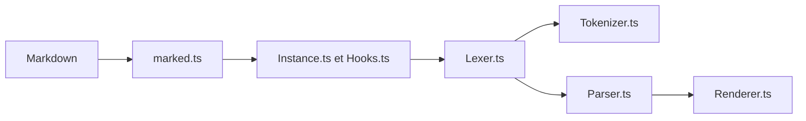

# markedjs/marked

> Markdown-to-HTML compiler in JavaScript, for browser, server and command line.

## The problem
Displaying Markdown (documents, model outputs, notes) as HTML without depending on an external service.

## What it actually does
The entry point applies options and hooks, the lexer splits blocks and then inline elements using the tokenizer and rules, then the parser turns the tokens into output and the renderer produces the HTML. Custom extensions and asynchronous hooks are documented. It handles GFM flavors.

## How it is wired


## Trying it
```bash
npm install -g marked
npm install marked
marked -o hello.html
marked --help
```

## Cost and gotchas
Free. The HTML produced is not sanitized: you must run the output through DOMPurify, sanitize-html or insane. Only current and LTS Node.js versions are supported.

## What it is not
It is not an HTML sanitizer: displaying untrusted Markdown without a filter opens the door to XSS. The license is present but not identified by GitHub.

## Alternatives
No alternative named in the README (DOMPurify, sanitize-html and insane appear there as complements).

## For you
Worth adopting to render Markdown in a dashboard or demo app, provided you sanitize the output; check the license text.
