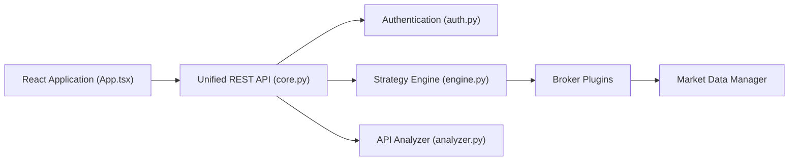

# marketcalls/openalgo

> Self-hosted algorithmic trading platform with a unified API for 36 brokers, mostly Indian.

## The problem
Each broker has its own API; writing, testing and running a strategy forces you to recode the integration.

## What it actually does
Flask + React application: `/api/v1` REST API, Python strategy host, Flow visual builder, twelve options tools, Analyzer mode (simulated capital of 1 crore), AI agent (LiteLLM/Ollama, every order asks for your approval), MCP server, Telegram bot. Five SQLite databases and one DuckDB.

## How it is wired


## Trying it
```bash
git clone --filter=blob:none https://github.com/marketcalls/openalgo.git
cd openalgo
pip install uv
cp .sample.env .env
uv run app.py
```

## Cost and gotchas
An account with a supported broker and API credentials in `.env`. Python 3.12+. The AI agent calls models at your expense. The README reminds you that trading loses money.

## What it is not
Not a prediction engine: it is execution and testing. Coverage centered on the markets these brokers serve.

## Alternatives
No alternative named in the README.

## For you
Ignore unless you have a trading project: outside the data/MLOps core, dependent on specific brokers and an AGPL license.
