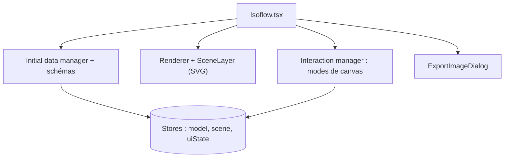

# markmanx/isoflow

> React component to draw network and architecture diagrams in isometric view.

## The problem
Architecture diagrams made by hand or with generic tools are hard to read and hard to embed in a web application.

## What it actually does
Drag-and-drop editor with icons, regions, connectors and text boxes, rendered in SVG with isometric projection. Icons come from an extensible system (AWS, Azure, GCP, Kubernetes plugins via @isoflow/isopacks). Export is done as an image or as code. Input data is validated by schema; the repository also contains a Next.js documentation app and a Docker entry.

## How it is wired


## Trying it
```bash
npm install isoflow @isoflow/isopacks
```

## Cost and gotchas
Free. The last push dates from September 2025. The README is only a few lines long: all the detail is in the external documentation.

## What it is not
Not a hosted diagram service: no backend in the repository. It is not an automatic diagram generator from code. The README says nothing about maturity or the roadmap.

## Alternatives
No alternative cited in the README.

## For you
Worth watching: handy for embedding architecture diagrams in MLOps documentation, but the project is not very active and poorly documented here.
