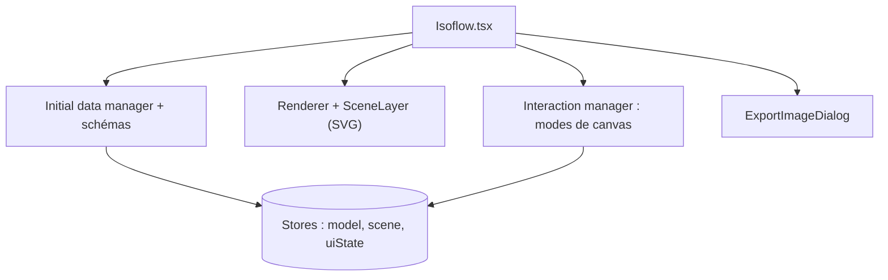

# markmanx/isoflow

> Composant React pour dessiner des schémas réseau et d'architecture en isométrique.

## Le problème
Les schémas d'architecture faits à la main ou avec des outils génériques sont peu lisibles et difficiles à intégrer dans une application web.

## Ce que ça fait vraiment
Éditeur glisser-déposer avec icônes, régions, connecteurs et zones de texte, rendu en SVG avec projection isométrique. Les icônes viennent d'un système extensible (plugins AWS, Azure, GCP, Kubernetes via @isoflow/isopacks). L'export se fait en image ou en code. Les données d'entrée sont validées par schéma ; le dépôt contient aussi une application de documentation en Next.js et une entrée Docker.

## Comment c'est branché


## Essayer
```bash
npm install isoflow @isoflow/isopacks
```

## Coût et pièges
Gratuit. Le dernier push date de septembre 2025. Le README tient en quelques lignes : tout le détail est dans la documentation externe.

## Ce que ce n'est pas
Pas un service de diagrammes hébergé : aucun backend dans le dépôt. Ce n'est pas un générateur automatique de schémas à partir de code. Le README ne dit rien de la maturité ni de la feuille de route.

## Alternatives
Aucune alternative citée dans le README.

## Pour toi
À surveiller : pratique pour intégrer des schémas d'architecture dans une doc MLOps, mais le projet est peu actif et peu documenté ici.

