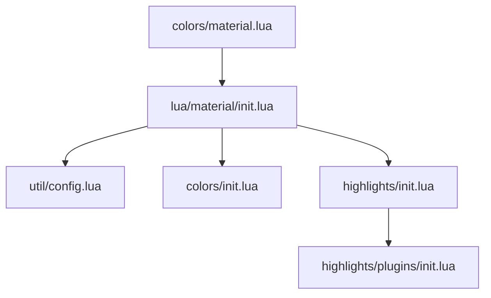

# marko-cerovac/material.nvim

> Neovim color theme inspired by the Material theme, with five styles.

## The problem
Older themes handle Neovim's LSP and Treesitter poorly.

## What it actually does
Five styles (oceanic, deep ocean, palenight, lighter, darker), support for many plugins, distinct backgrounds for sidebars, asynchronous loading of highlights and hot style switching. Two lualine themes and a Telescope picker. Everything is configured through `setup`.

## How it is wired


## Trying it
```lua
vim.g.material_style = "deep ocean"
vim.cmd 'colorscheme material'
```

## Cost and gotchas
Free. Neovim 0.7 or later. Load the theme after lualine, otherwise lualine's built-in theme takes over.

## What it is not
Not a theme that makes the editor transparent, even though the `disable.background` option lets you reuse the terminal background.

## Alternatives
No alternative named in the README.

## For you
Ignore: a simple color theme, with no effect on your data / AI / MLOps work.
