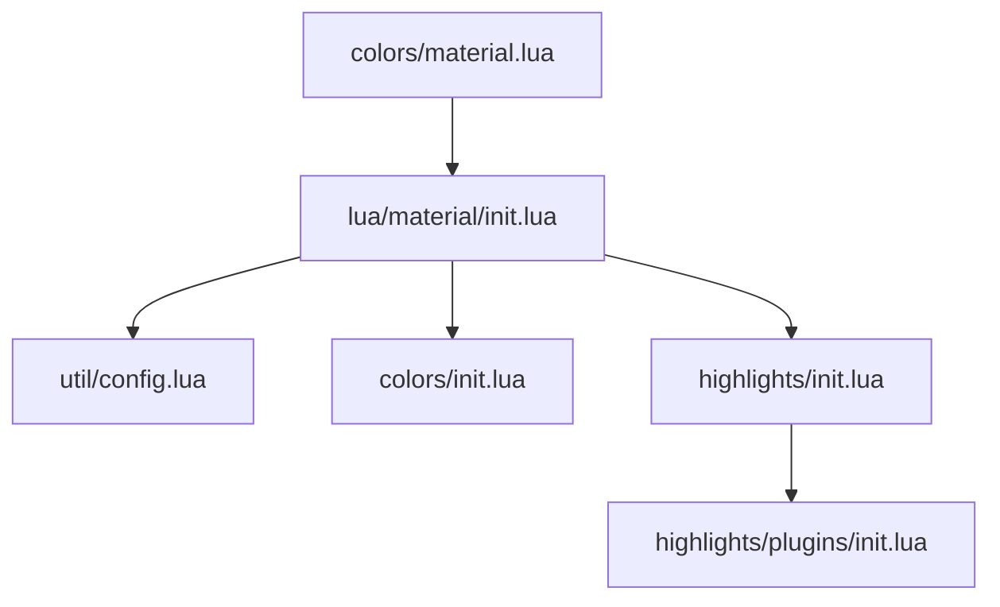

# marko-cerovac/material.nvim

> Thème de couleurs Neovim inspiré du thème Material, avec cinq styles.

## Le problème
Les thèmes anciens gèrent mal le LSP et Treesitter de Neovim.

## Ce que ça fait vraiment
Cinq styles (oceanic, deep ocean, palenight, lighter, darker), support de nombreux plugins, fonds distincts pour barres latérales, chargement asynchrone des surbrillances et bascule de style à chaud. Deux thèmes lualine et un sélecteur Telescope. Le tout se règle par `setup`.

## Comment c'est branché


## Essayer
```lua
vim.g.material_style = "deep ocean"
vim.cmd 'colorscheme material'
```

## Coût et pièges
Gratuit. Neovim 0.7 ou plus. Charger le thème après lualine, sinon le thème intégré de lualine prend le dessus.

## Ce que ce n'est pas
Pas un thème qui rend l'éditeur transparent, même si l'option `disable.background` permet de reprendre le fond du terminal.

## Alternatives
Aucune alternative nommée dans le README.

## Pour toi
Ignorer : simple thème de couleurs, sans effet sur ton travail data / IA / MLOps.

