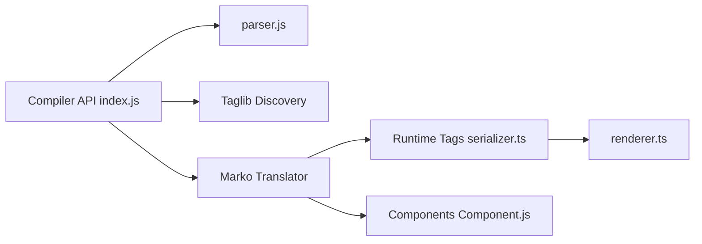

# marko-js/marko

> Declarative HTML-based language for reactive web interfaces, with a compiler and runtimes.

## The problem
Not documented in the provided README: it boils down to a file path (`packages/runtime-tags/README.md`).

## What it actually does
According to the architecture described from the code: a Marko template is parsed and compiled (compiler, taglib, Babel plugin, translator), then rendered by an HTML or DOM runtime. The repository also contains the legacy class-based runtime (components, virtual DOM, jQuery compatibility).

## How it is wired


## Trying it
```bash
# Aucune commande documentée dans le README fourni.
```

## Cost and gotchas
Free (MIT). README empty of content: usage information is missing here. 35 open issues.

## What it is not
Not assessable here: nothing beyond the architecture is provided.

## Alternatives
No alternative named in the README.

## For you
No link with a data/AI profile and too little material to decide better: keep an eye on it only if you do server-side web rendering.
