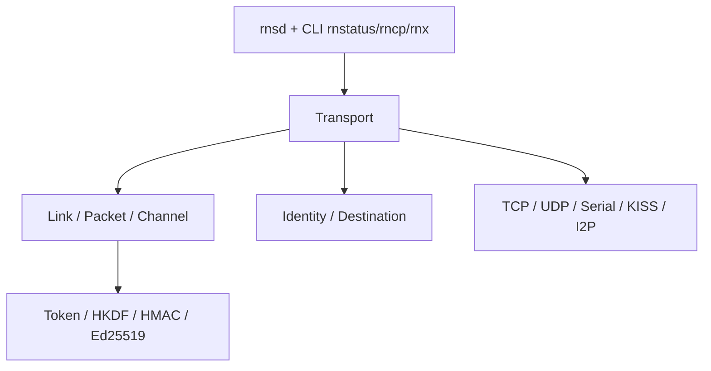

# markqvist/Reticulum

> An encrypted, IP-independent network stack in Python for building resilient mesh networks, even at very low bandwidth.

## The problem
Conventional networks depend on IP, carriers and central infrastructure; off-grid or over low-bandwidth radio, they fall apart.

## What it actually does
Reference implementation in Python (userland, no kernel module): identities based on Curve25519/Ed25519 keys, encrypted links, self-configuring multi-hop routing, with no source address in packets. It works through pluggable interfaces (TCP, UDP, serial, KISS, I2P, LoRa via RNode). Provides utilities (`rnsd`, `rnstatus`, `rncp`, `rnsh`...) and an API.

## How it is wired


## Trying it
```bash
pip install rns
pipx install rns
```
Then start `rnsd` (the daemon); a default configuration is created on first start.

## Cost and gotchas
Free. The `rnspure` package removes the dependencies but falls back to less battle-tested Python cryptographic primitives. No external security audit, according to the author. The repository is a public mirror; development happens elsewhere.

## What it is not
It is not a network to join: it is a tool for building one, and you have to find entry points. The protocol has no formal specification: the code is the reference. The "Reticulum License" is not recognized by GitHub.

## Alternatives
No alternative is named in the README; it warns against unreliable reimplementations.

## For you
Worth watching: relevant for resilient networking or offline IoT, much less for a standard data/AI workflow; the atypical license and the lack of an audit have to be weighed.
