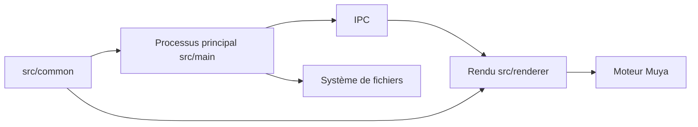

# marktext/marktext

> A desktop Markdown editor with live preview, for writing notes and documents.

## The problem
Writing Markdown in a text editor without seeing the rendering forces you to switch between source and preview.

## What it actually does
An Electron editor (in-house "Muya" engine, Vue interface) with live rendering, CommonMark and GFM, KaTeX formulas, front matter, HTML and PDF export, themes, source, typewriter and focus modes, image pasting. Available on Linux, macOS and Windows, with Homebrew, Chocolatey and Winget packages.

## How it is wired


## Trying it
```bash
brew install --cask mark-text
choco install marktext
winget install marktext
```

## Cost and gotchas
Free; sponsors are visible in the README. macOS 11 minimum, no universal build: choose arm64 or x64.

## What it is not
Not a linked-notes application nor a publishing tool; the README describes no synchronization.

## Alternatives
No alternative named in the README.

## For you
Adopt if you write documentation or notes in Markdown daily; otherwise of no importance.
