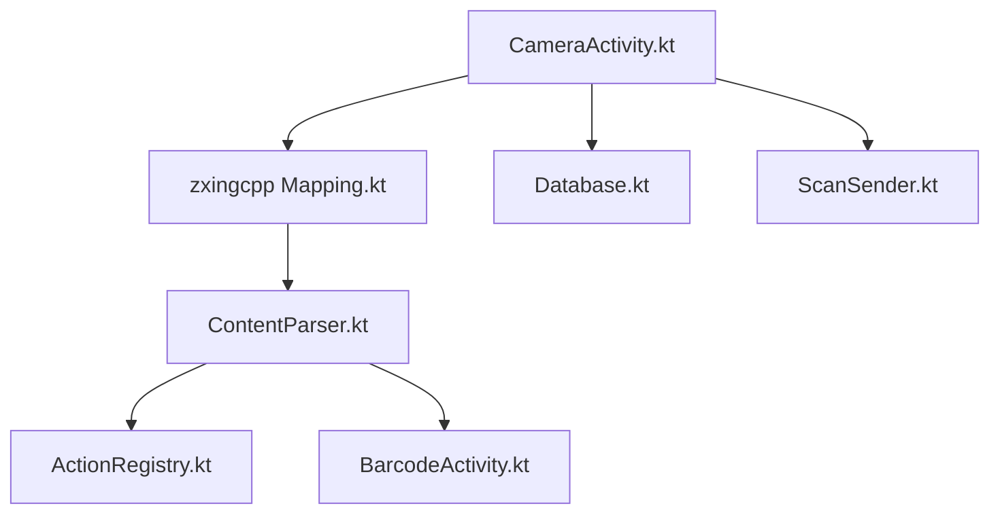

# markusfisch/BinaryEye

> Ad-free barcode reader and generator for Android, built on ZXing-C++.

## The problem
Barcode readers on the Play Store are often full of ads or closed source.

## What it actually does
Reads about twenty formats (QR, Data Matrix, EAN, PDF417...) and generates about ten. Works in portrait and landscape and reads inverted codes. Deep links and Intents allow it to be called from other apps; continuous scanning sends one JSON POST per code to an address. A Bluetooth relay goes through third-party companion apps.

## How it is wired

## Trying it
No documented install command. Example deep link: `binaryeye://scan?continuous=true&callback=...`.

## Cost and gotchas
Free, donations requested. Android only. The scan callback must answer with a 2xx and accept a POST; HTTPS is preferable.

## What it is not
Not a library: to embed it in an app, the README points to BarcodeScannerView.

## Alternatives
BarcodeScannerView to embed ZXing-C++ in an app; ML Kit for scanning on Android.

## For you
Ignore: Android utility, unrelated to your field, except for entering codes on the fly.
