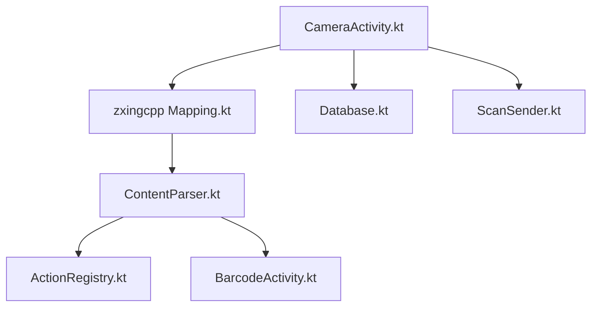

# markusfisch/BinaryEye

> Lecteur et générateur de codes-barres pour Android, sans publicité, appuyé sur ZXing-C++.

## Le problème
Les lecteurs de codes-barres du Play Store sont souvent bourrés de pub ou fermés.

## Ce que ça fait vraiment
Lit une vingtaine de formats (QR, Data Matrix, EAN, PDF417...) et en génère une dizaine. Fonctionne en portrait et paysage et lit les codes inversés. Des liens profonds et des Intents permettent de l'appeler depuis d'autres apps ; le scan continu envoie un POST JSON par code vers une adresse. Un relais Bluetooth passe par des applications compagnons tierces.

## Comment c'est branché

## Essayer
Aucune commande documentée pour l'installation. Exemple de lien profond : `binaryeye://scan?continuous=true&callback=...`.

## Coût et pièges
Gratuit, dons demandés. Android seulement. Le callback de scan doit répondre en 2xx et accepter un POST ; mieux vaut HTTPS.

## Ce que ce n'est pas
Pas une bibliothèque : pour l'intégrer dans une app, le README renvoie à BarcodeScannerView.

## Alternatives
BarcodeScannerView pour intégrer ZXing-C++ dans une app ; ML Kit pour scanner sous Android.

## Pour toi
À ignorer : utilitaire Android, sans rapport avec ton métier, sauf pour saisir des codes à la volée.

