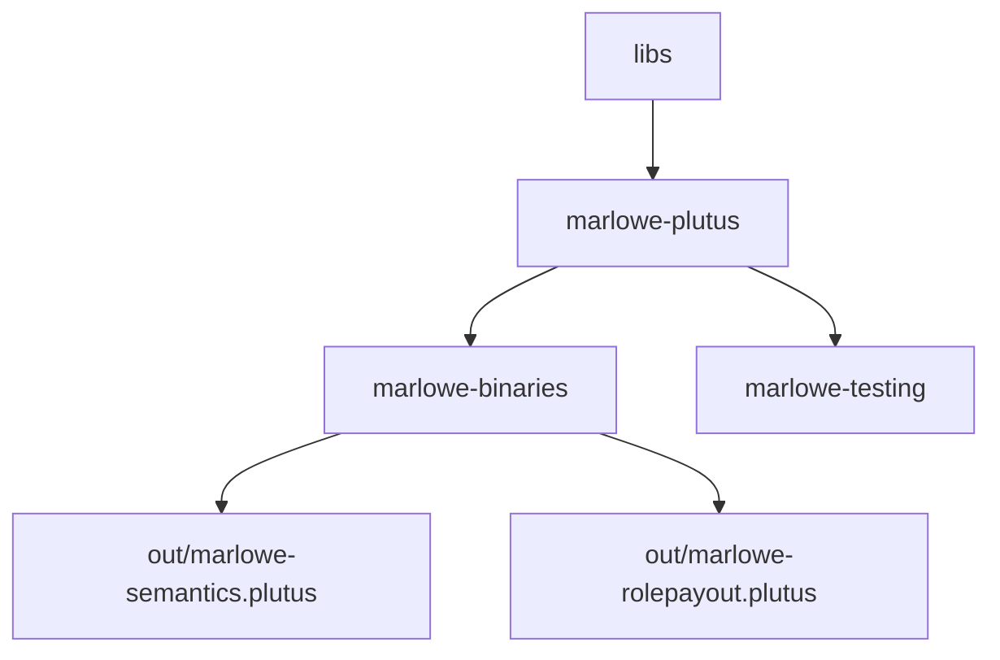

# marlowe-lang/marlowe-cardano

> Implementation of Marlowe on the Cardano blockchain: Plutus validators, runtime and tools.

## The problem
Writing verifiable financial contracts on Cardano requires a dedicated layer on top of Plutus.

## What it actually does
The repository contains the Marlowe DSL in Plutus, the Marlowe Runtime with a REST API, and static analysis tools. The marlowe-binaries CLI compiles the semantics and role-payout validators into .plutus scripts.

## How it is wired
Simplified diagram based on the card, no diagram provided.



## Trying it
```bash
nix develop
cabal build all
cabal run marlowe-binaries -- compile
```

## Cost and gotchas
Nix and Haskell (cabal) required, not in the prerequisites list: a heavy environment to set up. The history of main was rewritten on 6 October 2026; the old commits are under the legacy-final tag.

## What it is not
Not an AI or data tool: blockchain contract development.

## Alternatives
- No alternative named in the README.

## For you
Ignore: Cardano blockchain domain, outside the data / AI / MLOps scope.
