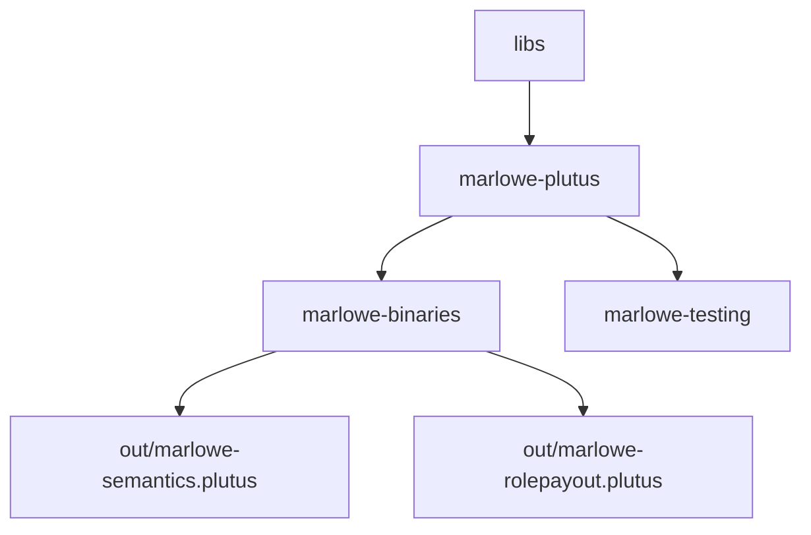

# marlowe-lang/marlowe-cardano

> Implémentation de Marlowe sur la blockchain Cardano : validateurs Plutus, runtime et outils.

## Le problème
Écrire des contrats financiers vérifiables sur Cardano demande une couche dédiée au-dessus de Plutus.

## Ce que ça fait vraiment
Le dépôt contient le DSL Marlowe en Plutus, le Marlowe Runtime avec une API REST, et des outils d'analyse statique. Le CLI marlowe-binaries compile les validateurs de sémantique et de paiement de rôle en scripts .plutus.

## Comment c'est branché
Schéma simplifié d'après la fiche, sans diagramme fourni.



## Essayer
```bash
nix develop
cabal build all
cabal run marlowe-binaries -- compile
```

## Coût et pièges
Nix et Haskell (cabal) requis, pas dans la liste des prérequis : environnement lourd à installer. Historique de main réécrit le 6 octobre 2026 ; les anciens commits sont sous le tag legacy-final.

## Ce que ce n'est pas
Pas un outil d'IA ou de données : du développement de contrats sur blockchain.

## Alternatives
- Aucune alternative nommée dans le README.

## Pour toi
Ignorer : domaine blockchain Cardano, hors périmètre data / IA / MLOps.

