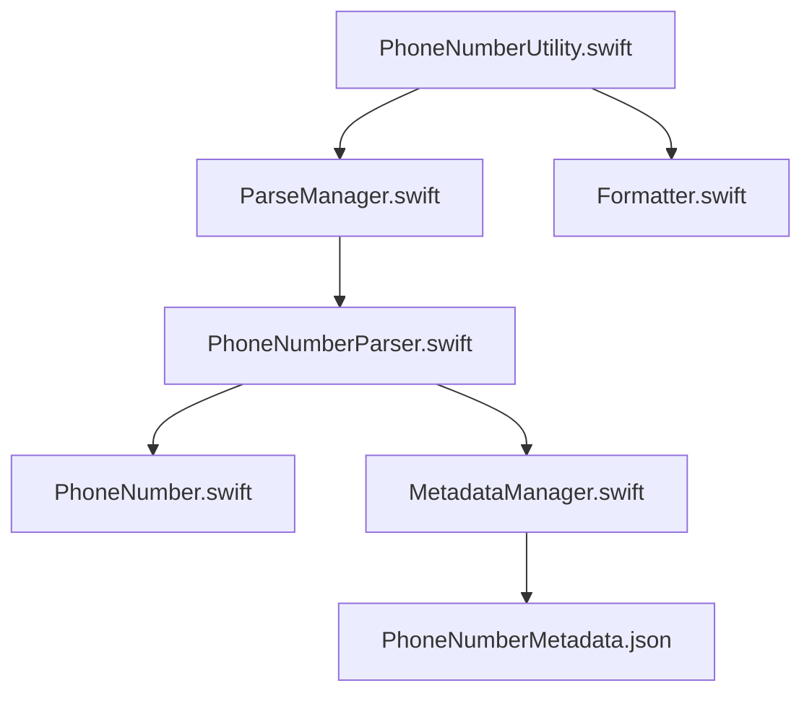

# marmelroy/PhoneNumberKit

> Swift library to parse, format and validate international phone numbers, now moved.

## The problem
Validating and normalizing phone numbers from every country in an iOS application requires up-to-date and complex metadata.

## What it actually does
The repository is frozen at version 4.3.0. The code parses text into a `PhoneNumber` object (country code, national number, type), formats it as E.164, international or national, and provides a `PhoneNumberTextField` with as-you-type formatting. The metadata comes from Google's libPhoneNumber project and is no longer updated here.

## How it is wired


## Trying it
```bash
brew install carthage
```
Adding via Swift Package Manager: `.package(url: "https://github.com/marmelroy/PhoneNumberKit", from: "4.0.0")`.

## Cost and gotchas
Free, but this repository is no longer maintained: the README asks to migrate to the PhoneNumberKit organization (repositories `PhoneNumberKit/PhoneNumberKit` 5.0+ and `PhoneNumberKitUI`). The validation data will age.

## What it is not
It is not the active version of the project. Nor is it a Python module; it only serves Apple applications.

## Alternatives
PhoneNumberKit/PhoneNumberKit: this is the official successor, maintained and kept up to date.

## For you
Ignore: frozen and reserved for Swift; if you need it, start directly from the repository taken over by the organization.
