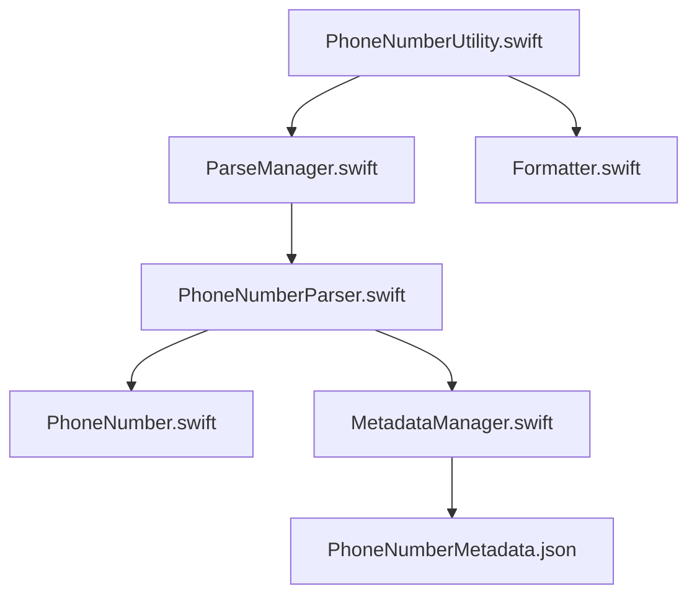

# marmelroy/PhoneNumberKit

> Bibliothèque Swift pour analyser, formater et valider des numéros de téléphone internationaux, désormais déplacée.

## Le problème
Valider et normaliser des numéros de téléphone de tous pays dans une application iOS demande des métadonnées à jour et complexes.

## Ce que ça fait vraiment
Le dépôt est gelé à la version 4.3.0. Le code analyse un texte en objet `PhoneNumber` (code pays, numéro national, type), le formate en E.164, international ou national, et fournit un `PhoneNumberTextField` avec formatage en cours de saisie. Les métadonnées viennent du projet libPhoneNumber de Google et ne sont plus mises à jour ici.

## Comment c'est branché


## Essayer
```bash
brew install carthage
```
Ajout par Swift Package Manager : `.package(url: "https://github.com/marmelroy/PhoneNumberKit", from: "4.0.0")`.

## Coût et pièges
Gratuit, mais ce dépôt n'est plus maintenu : le README demande de migrer vers l'organisation PhoneNumberKit (dépôts `PhoneNumberKit/PhoneNumberKit` 5.0+ et `PhoneNumberKitUI`). Les données de validation vont vieillir.

## Ce que ce n'est pas
Ce n'est pas la version active du projet. Ce n'est pas non plus un module Python, il ne sert qu'aux applications Apple.

## Alternatives
PhoneNumberKit/PhoneNumberKit : c'est la suite officielle, maintenue et mise à jour.

## Pour toi
À ignorer : gelé et réservé à Swift ; si tu en as besoin, pars directement du dépôt repris par l'organisation.

