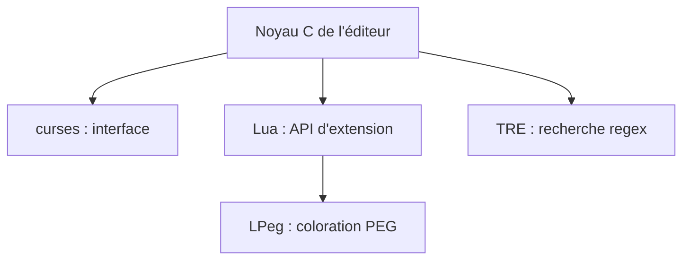

# martanne/vis

> Modal text editor in C that combines vi-style editing with sam's structural regular expressions.

## The problem
vim is heavy and carries a long legacy; the goal is a simple modal editor with multiple cursors and a more elegant command syntax.

## What it actually does
Vis extends modal editing with multiple selections and cursors, and a command language based on structural regular expressions. It handles Unicode and large or binary files. Syntax highlighting uses PEG grammars via LPeg, and a Lua API allows extensions. The README lists non-goals: tabs, file explorer, networking, ex mode, GUI.

## How it is wired

Simplified diagram based on the sheet, no diagram provided.

## Trying it
```bash
./configure && make && sudo make install
```

## Cost and gotchas
Free. C99 compiler and POSIX environment; curses recommended, Lua 5.2 or later and LPeg optional (highlighting), TRE optional. The license is "present but unidentified" according to GitHub. Many vim features are deliberately absent.

## What it is not
It is not a vim clone: it is not bug-for-bug compatible. It is not an IDE.

## Alternatives
vim (and sam) are cited as the references it draws inspiration from.

## For you
Keep an eye on it: a curiosity for anyone who likes modal editors, but with no added value for your data workflow compared with vim or an editor you already master.
