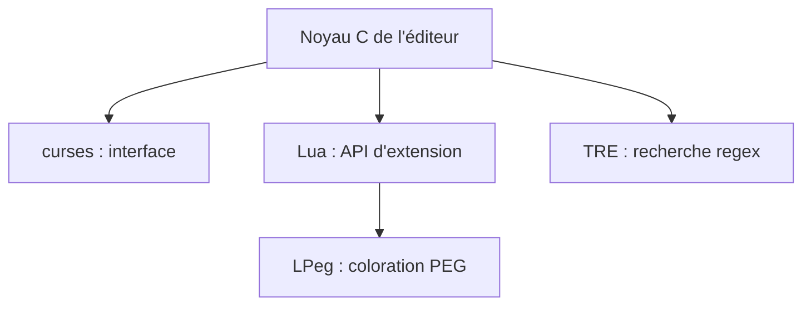

# martanne/vis

> Éditeur de texte modal en C qui combine l'édition à la vi et les expressions régulières structurelles de sam.

## Le problème
vim est lourd et hérité d'un passé chargé ; on veut un éditeur modal simple, aux curseurs multiples et à la syntaxe de commande plus élégante.

## Ce que ça fait vraiment
Vis étend l'édition modale avec des sélections et curseurs multiples, et un langage de commandes fondé sur les expressions régulières structurelles. Il gère l'Unicode et les fichiers volumineux ou binaires. La coloration utilise des grammaires PEG via LPeg, et une API Lua permet des extensions. Le README liste des non-objectifs : onglets, explorateur de fichiers, réseau, mode ex, GUI.

## Comment c'est branché

Schéma simplifié d'après la fiche, sans diagramme fourni.

## Essayer
```bash
./configure && make && sudo make install
```

## Coût et pièges
Gratuit. Compilateur C99 et environnement POSIX ; curses recommandé, Lua 5.2 ou plus et LPeg optionnels (coloration), TRE optionnel. La licence est « présente mais non identifiée » par GitHub. Beaucoup de fonctions de vim sont volontairement absentes.

## Ce que ce n'est pas
Ce n'est pas un clone de vim : il n'est pas compatible bug pour bug. Ce n'est pas un IDE.

## Alternatives
vim (et sam) sont cités comme références dont il s'inspire.

## Pour toi
À surveiller : curiosité pour qui aime les éditeurs modaux, mais sans valeur ajoutée sur ton flux data face à un vim ou un éditeur déjà maîtrisé.

