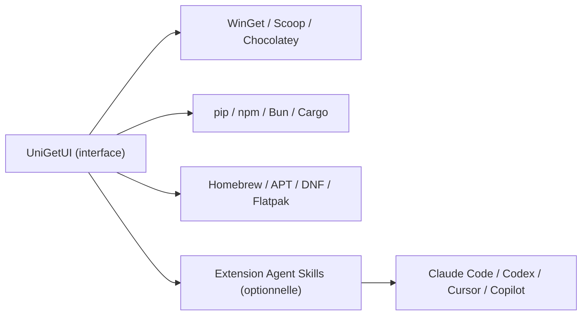

# marticliment/UniGetUI

> Single graphical interface to install and update software from several package managers, mainly on Windows.

## The problem
Each manager (WinGet, Scoop, Chocolatey, pip, npm…) has its own command line and updates to watch separately.

## What it actually does
Groups packages from WinGet, Scoop, Chocolatey, Homebrew, APT, DNF, Pacman, Flatpak, Snap, pip, npm, Bun, .NET Tool into a single window. Allows batch installation, scheduled updates, backup of the package list (local file or secret Gist) and a CLI. An optional extension, disabled by default, also manages skills and plugins for Claude Code, Codex, Cursor and Copilot.

## How it is wired

Simplified diagram based on the sheet, no diagram provided.

## Trying it
```bash
winget install --exact --id Devolutions.UniGetUI --source winget
scoop bucket add extras
scoop install extras/unigetui
choco install unigetui
```

## Cost and gotchas
Free, MIT license. The README warns against fake sites (wingetui and unigetui .com): the official repository indicated is Devolutions/UniGetUI, this repository is the old one. Antivirus software may flag the executable.

## What it is not
Not a package manager: it drives the existing ones. Packages come from third parties and may be compromised. Windows first, macOS and Linux builds exist but come later.

## Alternatives
- WinGet: the native command line that UniGetUI wraps, without an interface.
- Scoop: command-line manager, lighter if you do not need a window.
- Chocolatey: another manager that UniGetUI can drive.

## For you
Watch: useful for keeping a Windows work machine up to date, but with no direct link to data or MLOps, and the official repository has changed address.
