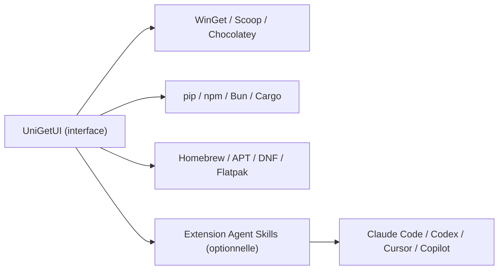

# marticliment/UniGetUI

> Interface graphique unique pour installer et mettre à jour les logiciels de plusieurs gestionnaires de paquets, surtout sous Windows.

## Le problème
Chaque gestionnaire (WinGet, Scoop, Chocolatey, pip, npm…) a sa ligne de commande et ses mises à jour à surveiller séparément.

## Ce que ça fait vraiment
Regroupe les paquets de WinGet, Scoop, Chocolatey, Homebrew, APT, DNF, Pacman, Flatpak, Snap, pip, npm, Bun, .NET Tool dans une seule fenêtre. Permet l'installation en lot, les mises à jour planifiées, la sauvegarde de la liste de paquets (fichier local ou Gist secret) et une CLI. Une extension optionnelle, désactivée par défaut, gère aussi des skills et plugins pour Claude Code, Codex, Cursor et Copilot.

## Comment c'est branché

Schéma simplifié d'après la fiche, sans diagramme fourni.

## Essayer
```bash
winget install --exact --id Devolutions.UniGetUI --source winget
scoop bucket add extras
scoop install extras/unigetui
choco install unigetui
```

## Coût et pièges
Gratuit, licence MIT. Le README met en garde contre de faux sites (wingetui et unigetui en .com) : le dépôt officiel indiqué est Devolutions/UniGetUI, ce dépôt-ci est l'ancien. Les antivirus peuvent signaler l'exécutable.

## Ce que ce n'est pas
Pas un gestionnaire de paquets : il pilote ceux qui existent. Les paquets viennent de tiers et peuvent être compromis. Windows d'abord, les builds macOS et Linux existent mais viennent après.

## Alternatives
- WinGet : la ligne de commande native que UniGetUI enveloppe, sans interface.
- Scoop : gestionnaire en ligne de commande, plus léger si tu n'as pas besoin d'une fenêtre.
- Chocolatey : autre gestionnaire que UniGetUI sait piloter.

## Pour toi
À surveiller : utile pour maintenir un poste Windows de travail à jour, mais sans rapport direct avec la data ou le MLOps, et le dépôt officiel a changé d'adresse.

